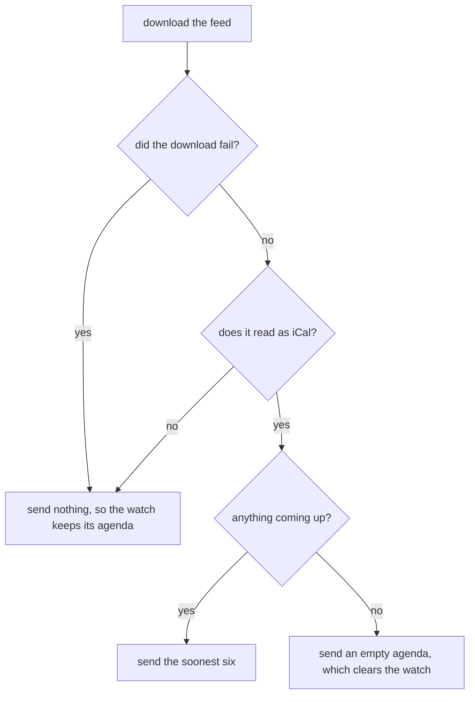

# The Calendar Store

The calendar store puts the wearer's next six events on the watch, each with its start, its end, whether it runs all day, a title, and a place. It reads any calendar that hands out a private iCal link, which covers Google, iCloud, and Outlook, with no account to sign into. The phone downloads the feed and does the hard part: repeating events, moved and cancelled meetings, and time zones. The watch keeps the result, saves it to flash, and asks for a fresh one on a schedule. A face starts the store, hands it a redraw function, and reads the events back.

The watch side lives in [`calendar_store.h`](../../src/c/pebble/io/stores/calendar_store.h) and [`calendar_store.c`](../../src/c/pebble/io/stores/calendar_store.c), and the strip is unpacked by [`calendar_wire.c`](../../src/c/core/wire/calendar_wire.c). The phone side is [`ical.ts`](../../src/ts/calendar/ical.ts) and [`feature.ts`](../../src/ts/calendar/feature.ts) under `src/ts/calendar/`. The polling deadlines, the tag byte on the saved copy, and the save that skips an unchanged agenda are shared with the other stores and covered in [How the Stores Work](stores.md).

## Setting It Up

On the watch, the face starts the store and subscribes its redraw:

```c
calendar_store_init((CalendarConfig){.live = true, .poll_min = 30, .persist_key = CALENDAR_KEY}, NULL);
calendar_store_subscribe(redraw);
```

`live`, `poll_min`, and `persist_key` mean the same as for every store, as [How the Stores Work](stores.md#the-shape-every-store-takes) covers, and a `CalendarSeed` pins a fixed agenda for screenshots. A store started with `live` false keeps that agenda, even one the face started live before.

On the phone, the face lists `calendar` in the `features` it passes to `startPebbleApp` (see [The Phone Side](phone-side.md#features)), which brings the `CALENDAR_STRIP` and `CALENDAR_REQUEST` message keys, and declares `CALENDAR_ICS_URL` for the link. The settings page's calendar section has one field for the link, with directions for finding it in Google, iCloud, and Outlook. Anyone holding that link can read the calendar, and the page tells the wearer to treat it like a password.

## Downloading the Feed

**Links as the Wearer Pastes Them.** A Subscribe link from iCloud starts `webcal://`, which every calendar app reads as `https://` and the phone's request does not know at all. The phone rewrites it before fetching.

**Past Any Cache.** Each download adds a query parameter that changes every time, so no cache between the phone and the calendar can hand back a copy from before the wearer's last edit. The cost is a feed served from a signed link, such as an S3 presigned URL, which refuses a changed query. The links calendars hand out are not signed.

**A Bad Download Changes Nothing.** What comes back decides what the watch hears:



An error page or a body cut off partway is not a calendar, and says nothing about what is on. Treating it as an empty one would wipe the wearer's agenda every time the network had a bad moment. A feed that reads clean with nothing in it is a real answer, and an empty agenda is how the watch hears that every event was deleted. With no link set at all, the phone sends an empty agenda too, so one left from a removed feed does not stay behind.

A download gives up after 15 seconds. When the wearer changes the link, the phone fetches the new feed straight after the save, and an answer still out for the old link is dropped when it lands, so an old feed can never overwrite a new one. [The Phone Side](phone-side.md#after-a-save) covers that rule for every feature.

## Which Hosts Feeds Come From

The calendar asks for any site, since the wearer's feed can sit anywhere. A face can list the hosts its wearers' feeds come from as `calendarHosts` in its appinfo's `providers`, and the calendar asks for those alone, as [What the Phone Lets It Reach](phone-side.md#what-the-phone-lets-it-reach) covers. With plugins on, a feed on a host the face did not list costs the wearer one failed fetch and a notification from the Pebble app, and loads once the wearer allows it. With plugins off, nothing is held to the list.

Each host covers its subdomains. These are the hosts the common services hand out links on:

| Service | Where the Feed Comes From | Host to List | Checked |
| :-- | :-- | :-- | :-- |
| Google Calendar, secret address | `https://calendar.google.com/calendar/ical/<id>/private-<token>/basic.ics`, or the older `https://www.google.com/calendar/ical/<id>/private-<token>/basic.ics` | `google.com` | yes |
| iCloud, public calendar | `webcal://p<NN>-caldav.icloud.com/published/2/<token>`, with the number varying per account | `icloud.com` | yes |
| Outlook.com, published calendar | `https://outlook.live.com/owa/calendar/<id>/<id>/calendar.ics` | `outlook.live.com` | yes |
| Microsoft 365, published calendar | `https://outlook.office365.com/owa/calendar/<id>/<id>/calendar.ics` | `outlook.office365.com` | yes |
| Proton Calendar, share link | `https://calendar.proton.me/api/calendar/v1/url/<id>/calendar.ics` | `calendar.proton.me` | partly |
| Fastmail, public calendar | believed to be `https://user.fm/calendar/v1-<token>/<name>.ics` | `user.fm` | no |
| Yahoo Calendar, ICS share link | somewhere under `calendar.yahoo.com` | `yahoo.com` | no |

Google takes `google.com` rather than `calendar.google.com`, since a wearer who saved their secret address years ago can still hold the `www.google.com` form, and the phone checks the host that link names. A face can list whichever hosts its wearers use.

## From a Pebble App Plugin

A face built with `PLUGIN_CALENDAR` can also read the events in the phone's own calendars, through the Pebble app's calendar plugin, as [Pebble App Plugins](plugin-sources.md) covers. The settings page gains a **Calendar Source** select, with **iCal Link** and **Pebble App: Preferred Source**, or with a `providers` list of `["plugin"]` the calendar reads from the plugin alone. The saved `CALENDAR_SOURCE` picks the mode, and a face declares that key even though its own page has no such row. With `plugin` saved, the phone subscribes to `calendar/event` and runs no iCal round. The mapping is in [`calendar.ts`](../../src/ts/plugin-sources/calendar.ts) and the mode in [`calendar-driver.ts`](../../src/ts/plugin-sources/calendar-driver.ts), both under `src/ts/plugin-sources/`. The plugin needs the `Calendar` permission, which the manifest lists for a face with the define.

**The Same Week.** A calendar plugin serves one instance per event. The phone reads its title and place, preferring the long text, and its start, end, and all-day flag. An event with no start is left off. A timed event with no end, or one that ends at or before its start, gets an hour, as an iCal event does. The events then go through the same window and sort as an iCal feed's, in [`window.ts`](../../src/ts/calendar/window.ts), so the agenda reads the same from either source.

**All-Day Events.** The watch reads an all-day time as the phone's local midnight, as the iCal reader sends it. The Pebble app's plugin sends UTC midnight instead, and Android and iOS disagree on the end. So the phone rounds every all-day start and end to the nearest local midnight, which puts each event on the day it means for a phone from UTC-12 to UTC+12. An all-day event whose end is missing, or rounds to its start, gets one day. Further east, as in New Zealand's summer, an all-day event reads a day late, since nothing in the plugin's data tells the two days apart.

**What Reaches the Watch.** The plugin sends on every change, and the phone sends each update as it comes, cut to the soonest six. An update with no events sends an empty agenda, since that is how the watch hears every event was deleted, and the settings page then shows a note saying the Pebble app may need permission to read the phone's calendars, or that those calendars may be switched off in its calendar settings. An error sends nothing, since the watch has no status line for the calendar, so the watch keeps its agenda and the settings page explains. A watch ask resends the last update as of now, so an event that ended since is left off.

**The Agenda Hold after a Reset.** On a fresh install of the Pebble app, the face's phone code starts before the watch's settings reply lands, while the phone holds no settings at all. An iCal round then has no link, and its empty agenda would clear the watch, only for the restore to bring back the plugin a moment later. So while the phone holds no settings, the settings request is still out, and a plugin could answer, an iCal round with no link sends nothing. The hold lifts when the restore lands, when the watch turns every settings request away, or after 15 seconds, and the held round then runs once, so a watch on iCal with no link still learns its agenda is empty. A face with no `SETTINGS_REQUEST` key never holds. [The Life of a Setting](life-of-a-setting.md#after-a-reinstall) covers the restore.

**The Link Is Not Kept.** The watch keeps the plugin choice through a reset, as [Keeping a Plugin Source](settings-on-the-watch.md#keeping-a-plugin-source) covers, but it keeps no copy of the iCal link. A wearer on an iCal link pastes it again after a reset.

## Which Events Make the Strip

[ical.js](https://github.com/kewisch/ical.js) reads the feed and handles the iCal rules. The framework chooses what the watch shows.

**The Window.** An event makes the list when it has not finished yet and it starts before the end of the sixth day after today, on the phone's clock. That is today and the next six days, so a two-letter weekday code never appears twice in the list. The last day runs to its midnight rather than to six days from the moment of the fetch, so an evening event on it is not dropped while a morning one is kept. A meeting already under way still counts, since it is judged by its end.

**Soonest First.** The phone sorts the events by start and sends the first six to the watch. An all-day event starts at midnight, so it leads its day.

**Lengths the Feed Leaves Out.** The phone gives a timed event with no end and no duration an hour, so a free and busy panel has a block to shade. An all-day event ends at the midnight after its last day, counted in calendar days rather than 24 hour steps, so it still ends at midnight on a day the clocks change.

**Cancelled Events.** Outlook keeps a cancelled meeting in the feed and marks it cancelled rather than taking it out. The phone leaves those off, and a single cancelled occurrence of a series leaves a gap on that day.

**Repeating Events.** The phone walks each repeating event from its first occurrence and keeps the ones inside the window. Days the feed excludes are skipped. An occurrence the feed moved or renamed is read from its own entry, with its own time and title, and it is judged by where it landed, so a meeting moved into this week from next month still shows. Moved occurrences are matched to their series by its ID. Left to itself, ical.js applies every moved occurrence in the calendar to every series, so one moved meeting would replace an occurrence in every other series that met at the same time. A moved occurrence whose series is not in the feed shows as a plain event.

**A Cap on the Walk.** Starting the walk near the window would be quicker, but ical.js loses the occurrence count on the way, so a rule that ran its three times last January would come back with three more this week. So the walk starts where the rule does and stops after 10,000 steps. A daily rule set up as long as 27 years ago still reaches this week. An hourly one set up more than about 14 months ago does not, and it is left off with a line in the phone's log rather than vanishing without a word.

**One Bad Event Costs Only Itself.** ical.js throws on a rule it cannot walk and on an event with no start. That event is skipped, and the rest of the calendar still shows.

**Time Zones.** A feed states a timed event in a named zone and defines that name in the feed itself, and ical.js matches the two. So Outlook's `Eastern Standard Time`, which is not a name the phone knows, needs no table. A zone the feed names but never defines has no answer, and its times are read on the phone's own clock.

## What Reaches the Watch

**Absolute Times.** Each event's start and end go as seconds since the epoch, so the watch works out "in 20 minutes" against its own clock between polls rather than showing a countdown frozen at the moment of the fetch. An end past 2038 is pinned to the largest the field holds, as [The Message Formats](message-formats.md#the-agenda) covers.

**Plain ASCII Text.** The phone flattens each title and place to the characters the watch fonts carry, as [The Message Formats](message-formats.md#text-on-the-way-over) covers. The title is cut to 24 characters and the place to 16. An event with no title goes over as `(no title)`.

**A Bad Strip Changes Nothing.** A count above six is pinned to six, and a message that runs short is refused whole, so the store keeps the agenda it had rather than half of a new one.

**When the Phone Sends.** The phone sends an agenda when its code starts, whenever the watch asks, and when the link changes. A watch ask within a minute of a good download resends that agenda rather than downloading the feed again. Its slow refresh fills in when the watch has not asked, as [The Phone Side](phone-side.md#the-background-refresh) covers.

## On the Watch

**Reading It Back.** `calendar_store_strip` gives the whole agenda, and `calendar_store_event` gives one event or `NULL` past the filled count. The store keeps the agenda exactly as the phone sent it. An event that finishes between polls stays in the list until the next one arrives, so a panel that shows what is next skips anything already over:

```c
static const CalendarEvent *next_event(time_t now)
{
    const CalendarStrip *strip = calendar_store_strip();

    for (uint8_t index = 0; index < strip->count; index++)
    {
        if (strip->event[index].end > now)
        {
            return &strip->event[index];
        }
    }

    return NULL;
}
```

**Saved to Flash.** Six events do not fit in a single persist key, which holds 256 bytes, so the store saves the first four and the time they arrived. A relaunch shows those four straight away, and the first ask brings the full six back. A change that only touches the fifth or sixth event leaves the saved four the same, so it writes nothing. The restore gives every title and place a closing zero, so a damaged copy cannot send a panel past the end of the text. A failed write waits for the next agenda that differs, for the reason in [How the Stores Work](stores.md#skipping-unchanged-writes).

**After a Lost Connection.** When the phone comes back, a live store asks again only for an agenda at least its own interval old, or when it holds none, as [How the Stores Work](stores.md#polling-on-wall-clock-deadlines) covers. A drop keeps the agenda on show.

**How Old It Is.** `calendar_store_age_s` gives the seconds since the last agenda arrived, or -1 for none.
