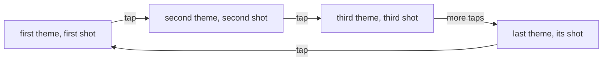
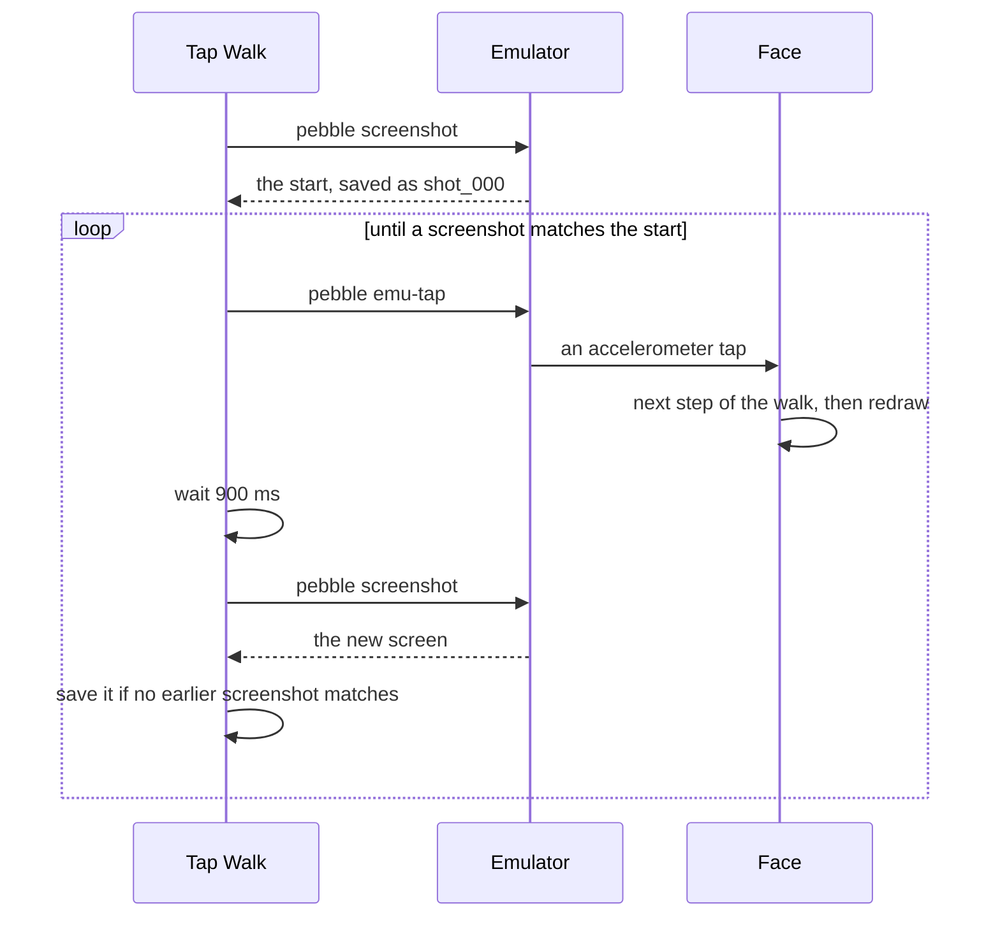

# The Dev Plugin

The `dev` plugin is for working on a face rather than wearing it. On the watch it has a harness that fills the stores with fixed readings and steps the face through its themes, its panels, or a list of screens on a tap, so the same build draws the same screen every time it runs. On the computer, `clay-preview` builds the face's settings page into a file a browser opens, `tap-walk` drives the emulator through the harness and saves a screenshot of every screen it reaches, and `thumbnails` crops the layout builder's panel pictures out of a walk. A face lists the plugin once, `paf build <face> --dev` turns the harness on, and a file beside the unit's `paf.config.json` picks its walk and its clock, and can set its settings, its readings, and walks of its own. A build without `--dev` leaves the harness off, so none of it reaches a release.

The harness is [`dev_walk.h`](../../src/plugins/dev/c/dev/dev_walk.h) and [`dev_walk.c`](../../src/plugins/dev/c/dev/dev_walk.c) under `src/plugins/dev/c/dev/`, with [`dev_config.h`](../../src/plugins/dev/c/dev/dev_config.h) and [`dev_config.c`](../../src/plugins/dev/c/dev/dev_config.c) beside them for what the file sets, and a face calls it through the hooks in [`dev_hooks.h`](../../src/plugins/dev/c/dev/dev_hooks.h). The build reads the switches with [`dev-switches.ts`](../../src/tools/manifest/dev-switches.ts), and writes the header the harness reads with [`dev-header.ts`](../../src/tools/manifest/dev-header.ts). The tools are [`clay-preview.ts`](../../src/plugins/dev/clay-preview.ts), [`tap-walk.ts`](../../src/plugins/dev/tap-walk.ts), and [`thumbnails.ts`](../../src/plugins/dev/thumbnails.ts) beside it. A face runs them with `paf tool <face> clay-preview`, `paf tool <face> tap-walk`, and `paf tool <face> thumbnails`, which [the paf commands](../paf/commands.md#paf-tool) cover. The framework repo also checks the settings page in a browser with `page-check.ts`, which [Checking the Page in a Browser](#checking-the-page-in-a-browser) covers.

## Listing the Plugin

A unit lists the plugin under `plugins` in its `paf.config.json`, as `"dev": {}`. It takes no settings there, and the build stops on any, since the switches live in a file of their own that [Turning It On for a Dev Build](#turning-it-on-for-a-dev-build) covers. `paf` then copies it into the unit's `paf/plugins/dev/`, and its tools become available to every face in the unit.

**The Harness Joins the Build.** The build stages each folder under a listed plugin's `c/` beside the framework's own C, so the plugin's `c/dev/` lands as `dev/` and a face includes `dev/dev_hooks.h`. A face can keep its own `src/c/dev/` folder, since only whole paths clash. A face with its own `dev/dev_walk.h` or `dev/dev_hooks.h` stops the build, which names both files rather than compile against whichever one the include path finds first.

## Fixed Readings for Screenshots

`dev_walk_seed_stores(hour, minute)` starts the time, weather, health, system, and location stores from one fixture, with `live` false and the clock pinned. The `dev_seed_stores` hook calls it on the clock the switches pin, in place of those stores' live inits. The stock and calendar stores start empty with `live` false on a face that declares `STOCK_STRIP` or `CALENDAR_STRIP`, so a face that shows quotes or an agenda seeds its own after the call. The phone battery and now playing stores start empty the same way on a face that declares their keys, since the seeded system store tells them nothing about the link. Call it after `settings_init`, since the weather seed takes the wearer's temperature unit. A store the unit's `paf.dev.config.json` gives readings for takes those in place of the fixture, as [Readings from the Config](#readings-from-the-config) covers. A seeded store shows its seed and nothing else, and [How the Stores Work](stores.md#seeded-for-screenshots) covers why nothing from the phone or the watch's services can replace it.

**The Fixture.** The readings come from a table of shots, one per step of the theme walk below, and the first shot is what a face shows with no walk running: 21 degrees Celsius and partly cloudy, a heart rate of 72, 8,431 steps, the battery at 64 percent, the phone connected, and the Quiet Time mark down. Every shot also carries the same 420 calories, 7 hours 11 minutes of sleep, 52 active minutes, and 5.3 km walked. The battery never reads as charging, and the system store has no next alarm. On a watch set to Fahrenheit each temperature goes in converted, so 21 degrees shows as 70F.

**The Pinned Clock.** The time store gets the hour and minute the switches pin with the seconds at 0, and no ticker runs. Without a `date` in the file the date is not pinned. It comes from the watch's clock when the stores are seeded, so a face that shows the date draws the day it runs, and a screenshot taken tomorrow differs in the date alone. A `date` pins it too, as [Turning It On for a Dev Build](#turning-it-on-for-a-dev-build) covers.

**Everything Else Reads as Missing.** The weather seed starts from `WEATHER_SEED_EMPTY` and sets only the temperature and the condition. Humidity, wind, UV, sunrise, sunset, the high and low, and the forecast all keep their no-data values, so a panel showing one draws dashes rather than a 0 that looks real. A face whose screenshots need those readings gives them in the file's `stores` block.

**Only What the Face Declares.** The harness only fills the weather and location stores for a face that declares their message keys. [`appmessage_features.h`](../../src/c/pebble/io/appmessage/appmessage_features.h) defines `APPMESSAGE_HAS_WEATHER` when the face declares all four weather keys and `APPMESSAGE_HAS_LOCATION` when it declares both coordinate keys, which [Talking to the Phone](talking-to-the-phone.md) explains. Without them the harness still starts the store, empty and not live. A face without weather can still link a readout that reads the weather store, and an untouched store would hold zeros where a started one holds its no-data values.

**The Coordinates Are Text.** The location store keeps whatever text the face's phone code formats, as [The Location Store](location-store.md#how-a-fix-arrives) covers. The fixture's coordinates are the text `33-44` and `-112-07`, so a face that formats its coordinates as decimals or with hemisphere letters shows the fixture in a style its real readings never take.

## The Theme Walk

`dev_walk_init(mode, apply_theme)` starts the harness once the engine is up, and the `dev_start` hook calls it with the walk the switches pick. `apply_theme` is the face's own hook for a theme change, such as recolouring its zones or swapping a frame picture. The harness runs it, then calls `engine_rebuild` so the whole face repaints.

With `DEV_WALK_NONE` that is all it does, and the face shows the fixture in whichever theme its settings hold. With `DEV_WALK_THEMES` it forces the first theme and subscribes to the accelerometer's tap service. Each tap moves to the next theme, seeds the stores again from the shot with the same number, sets that shot's Quiet Time mark, runs the face's hook, and rebuilds. After the last theme a tap comes back to the first:



**A Range of Readings.** The table holds eight shots, spread across temperatures from -8 to 35 degrees, six different conditions, a battery from 8 to 100 percent, the phone dropped in two shots, and the Quiet Time mark up in four. A sheet of every theme is also a sheet of how the face draws a flat battery, a lost phone, or snow. A face with fewer than eight themes uses the first shots, and a ninth theme starts the table again.

**The Number of Themes.** The walk asks the settings layer how many values the theme setting allows, which is the same count that caps a theme sent from the phone. Every theme the watch accepts is in the walk, without the walk being told how many there are. A face with no theme setting gets a count of 0, so every tap redraws the first theme and the walk never moves.

**Nothing Is Saved.** The harness writes the theme and the Quiet Time mark with `settings_set_u8`, which changes the value in memory and never touches flash. A dev build never saves settings at all, so a save that lands on top of the walk, such as one from the emulator's phone or the time zone push the phone sends when it is ready, leaves the settings the face had saved there as they were. A save made on the settings page against a dev build is not kept either. On a face that has no Quiet Time setting, the write does nothing.

**A Face's Own Walks.** A walk through panels, layouts, or a list of settings is best laid out in the file, as [Walks the Config Lists](#walks-the-config-lists) covers, and leaves the face one small hook. A walk the file cannot express is a tap handler that changes one thing and rebuilds, so a face can still write its own beside the plugin's, such as one that steps the weather condition through every icon, day and night. It lives in the face's own `src/c/dev/` and seeds the stores the same way, and `tap-walk` drives it like the theme walk. It reads its own name from the build, as [A Face's Own Switches](#a-faces-own-switches) covers, so the unit or the face's own entry picks it by its name and the plugin's theme walk stays off.

## Turning It On for a Dev Build

`paf build <face> --dev` builds a face in dev mode, which boots it on the fixture. Without `--dev`, the face builds as it ships. The harness a dev build runs with lives in `paf.dev.config.json`, beside the unit's `paf.config.json`:

```json
{ "walk": "themes", "clock": "10:42" }
```

A face repo commits the file, so anyone who checks out the repo takes the same screenshots. It holds nothing but the harness, and a dev build in a unit with no such file takes the defaults. Nothing in it turns dev mode on, so CI and a release, which build without `--dev`, build with the mode off whatever the file holds. `paf` itself neither copies nor reads the file, so it stays where it is through a `paf sync` or a `paf pin`.

**`walk`:** the walk a tap steps through, by its name in lowercase. `themes` is the plugin's theme walk. Left out, the face shows the fixture and a tap changes nothing.

**`clock`:** the pinned time, as 24-hour `HH:MM`. Left out, it is `08:00`, which is a wide clock string.

**`date`:** the pinned date, as `YYYY-MM-DD`. Left out, the date is the watch's own. The build works out the weekday and the day of the year, so a date panel draws the same day on every run.

**`settings`:** settings the face starts on, by message key, as [Settings from the Config](#settings-from-the-config) covers.

**`stores`:** readings in place of the fixture, store by store, as [Readings from the Config](#readings-from-the-config) covers.

**`walks`:** walks laid out as lists, by name, which `walk` picks like any other, as [Walks the Config Lists](#walks-the-config-lists) covers.

**`panels`:** what each panel and size is to the face's C, for a panel walk and the `thumbnails` tool, as [The Panels Block](#the-panels-block) covers.

**`faces`:** an entry for each face that needs settings of its own, by the name `paf build <face>` takes. An entry takes everything the top takes but `faces`. A `walk`, `clock`, `date`, or `panels` it leaves out comes from the top of the file. Its `settings`, `stores`, and `walks` go on top of the top's one by one, so an entry that sets one setting keeps the rest of the top's. A face with no entry takes the top's settings, so a unit that holds one face needs no `faces` at all. A `"walk": null` in an entry turns the top's walk off for that face. A family whose faces walk differently commits one file for all of them:

```json
{ "walk": "themes", "faces": { "night-face": { "walk": "layouts", "clock": "20:42" } } }
```

The build turns them into C defines for every face it builds. `DEV_MODE` is 1 with `--dev` and 0 without. With `--dev` it also sets `DEV_TIME_HOUR` and `DEV_TIME_MIN` from the clock, and `DEV_TAP_WALK_<NAME>` to 1 for the walk, so `"walk": "themes"` sets `DEV_TAP_WALK_THEMES`. A walk the file lists sets `DEV_WALK_FROM_CONFIG` in its place, so a face's own C walk that reads the same name stays off and only one walk takes the taps. The date, the settings, the readings, and a listed walk's steps go into `page/dev_harness.h`, which the build writes into each of the face's sandboxes beside `settings_page.h` for a dev build, and takes away for any other. Only `dev_config.c` includes it. A build without `--dev` gets `DEV_MODE` 0 and nothing else, in a unit that lists the plugin or not, so C that reads `DEV_MODE` as a value, such as `.live = !DEV_MODE`, compiles on every face. A face whose own header still says `#define DEV_MODE 0` builds as before, since a define repeated with the same value is allowed.

**What Stops a Build.** Every build, with `--dev` or without, stops on a `mode` anywhere in the file, a face's entry included, with a line saying to drop it and build with `--dev`, since the file cannot turn dev mode on. It also stops on settings left in the plugin's block in `paf.config.json`, and on a face's appinfo that sets one of these defines itself. A build without `--dev` checks nothing else in the file, so a slip in the harness never stops CI or a release, and a file that does not parse still builds. A build with `--dev` checks the whole file, every face's entry and not only the face being built, and stops with a line naming the problem on any of these:

- a file that is not valid JSON, or that holds something other than an object
- a setting the plugin does not read, at the top or in a face's entry
- a walk that is not a lowercase name, or a clock that is not a 24-hour `HH:MM`, such as `8:00`
- a date that is not a real day as `YYYY-MM-DD`, from 1970 to 2037
- a setting on a key the face does not declare, or with a value that is not a whole number, true or false, or text
- a setting whose value the face's settings page would not take, such as text for a colour, a number for a text box, or a choice past the ones the page offers
- a store the plugin does not seed, a reading the store does not take, a number outside what the store holds, text longer than the watch keeps, or a weather condition the watch has no icon for
- a store the face cannot show, such as stocks on a face without `STOCK_STRIP`, or HRV on a face built without `HEALTH_HRV`
- an HRV reading after the pinned clock, or runs of them out of time order
- a listed walk named `themes`, a step walk of fewer than two steps, or a panel walk with no panels block, a size the block does not list, or a panel it gives no id
- a step walk whose later steps set a key that neither the settings nor its first step sets, or whose first step has no layout while a later one does
- a `faces` that is not an object, or an entry in it that is not one
- an entry for a name the unit has no face by, with a line listing the faces it has, since a renamed or mistyped face would otherwise take the top's settings without a word
- a unit whose `paf.config.json` does not list the plugin as `"dev": {}`, since the harness only comes with it
- a plugin app named on its own, which has no watch code for dev mode to change. `paf build all --dev`, and `tools/build.ts all --dev` run by hand, pass over a plugin app with a line saying so and build the rest

The defines go on every compile's flags, so a switch between a dev build and a normal one, or a change to the file, needs no clean build.

**The Hooks.** A face includes `dev/dev_hooks.h`, whose hooks are `static inline` and turn into nothing with the mode off, so `main.c` calls them without any `#if` of its own. It skips the live inits when the stores were seeded, starts the walk once the engine is built, and stops it on the way out, which drops the tap subscription:

```c
#include "dev/dev_hooks.h"

if (!dev_seed_stores())
{
    time_store_init((TimeConfig){.live = true, .minute_tick = true}, NULL);
    weather_store_init((WeatherConfig){.live = true, .poll_min = 30, .persist_key = WEATHER_KEY}, NULL);
    // and the rest of the face's live inits
}

engine_init(window, build_face);
window_stack_push(window, true);
dev_start(apply_theme);
```

`dev_stop()` goes in the face's deinit. `dev_seed_stores` applies the file's settings, then seeds the stores on the pinned clock and returns true. `dev_start` runs the theme walk when the switches pick `themes`, runs a walk the file lists when they pick one, and otherwise paints the fixture once and leaves the taps alone. The hook it takes runs after each step of either walk, before the engine rebuilds, so a face that sets its window's background from the theme passes the same function its settings handler runs. `dev_force_time` sets a `struct tm`'s hour and minute to the pinned clock, and its date to a pinned date, for a panel that builds a time of its own, such as a second time zone, so every panel in a screenshot shows the same time and day.

**One Set of Hooks.** A face that includes `dev/dev_hooks.h` deletes its own `dev_seed_stores`, `dev_start`, `dev_stop`, and `dev_force_time` everywhere, in every file and in its family core too. Two copies in one file stop the build, but each copy is `static`, so one left in a file that never includes the plugin's header builds without a word and runs its own switches in that file alone.

**A Face's Own Switches.** A face's own C reads the same defines with `#if DEV_MODE`. A walk of its own reads its own name, so a face with a walk through its layouts reads `DEV_TAP_WALK_LAYOUTS`, which `"walk": "layouts"` sets. A choice that only matters with the mode on, such as which theme a shot forces, stays in the face's own header under `#if DEV_MODE`. A plain `#define DEV_MODE` in a face's header stops the build on the redefinition whenever its value differs from the build's, since the build sets it too.

**The Whole Unit.** The file belongs to the unit, so in a family one file holds every face's harness, and each face takes its own entry or the top's settings. `--dev` covers only the faces the build names, so `paf build <face> --dev` leaves the family's other faces as they last built. A face with a walk of its own that the unit did not pick still builds, with its walk off.

**Out of a Release.** A release builds the face without `--dev`, so `DEV_MODE` is 0, `dev_seed_stores` returns false, the live inits run, and `dev_hooks.h` never includes the harness's header. The build takes away any `page/dev_harness.h` an earlier dev build left, and `dev_config.c` compiles to nothing. `dev_walk.c` is still compiled for every face in a unit that lists the plugin. The Pebble SDK puts each function in its own section and has the linker drop any section nothing calls, so a face that never calls the harness ships none of it. A plain `#define DEV_MODE 1` left in a face's header clashes with the build's 0 and stops every build without `--dev`.

**A Settings Save Keeps the Stores Pinned.** Only a store's init decides whether it is live. The harness starts the time, weather, health, system, and location stores with `live` false, and the stock, calendar, phone battery, and now playing stores too on a face that declares their keys. A face's settings handler reconfigures its stores with `live` true, and each store the harness seeded stays seeded through that. A store nothing started, such as the stock store on a face without `STOCK_STRIP`, ignores the reconfigure. So a save from the settings page on the emulator's phone leaves the clock on its pinned time, and the weather, stock, and calendar stores fetch nothing and spend none of the provider's quota. The face's settings handler needs no check of its dev switch, and passes the same rules in a dev build as in a release.

## Settings, Readings, and Walks from the Config

The file can hold the rest of a face's screenshot setup, so a face needs no dev code of its own beyond a hook for a walk through its panels or layouts. Every block here is read only by a build with `--dev`, and checked against the face, so a slip stops the dev build with a line naming it rather than showing up as a screenshot that is quietly wrong.

### Settings from the Config

`settings` gives settings by message key, with the value the settings page sends: a number for a choice, a whole number, or a colour as `0xRRGGBB`, `true` or `false` for a toggle, and text for text:

```json
{ "settings": { "APPEARANCE_THEME": 1, "CLOCK_TIME_FORMAT": 2, "CLOCK_TIMEZONE_1": "0,Time Zone 1" } }
```

`dev_seed_stores` writes them into a dictionary and hands it to `settings_apply_inbox`, which is what a save from the phone runs through. So a face's own field takes its value the same way a shared one does, and the face writes no code to force a theme or a time format. A dev build never saves settings, so the settings on the emulator's flash stay as they were, as [Nothing Is Saved](#the-theme-walk) covers. A key the face does not declare stops the build. Once the build has read the settings page, it also stops on a value the catalogue would not take: text for a key the page shows as a colour, toggle, or choice, a number for a text box, and a choice past the ones the page offers. The watch would skip the first two and reset the last to its default, so each would show the wrong screen without a word. A key the page has no control for, and the framework does not keep, takes any value, since its type is the face's alone. A face that keeps something outside its settings table, such as a string it splits across two keys, sets it in its own `dev_show_layout` hook, below.

### Readings from the Config

`stores` gives readings in place of the fixture, store by store. A store the block names takes the block's readings on every step of every walk, the theme walk included, and a reading it leaves out reads as no reading on the watch, the way a phone message that left it out would. A store the block leaves out keeps the fixture, so the theme walk still moves it. Each store takes the fields its C seed has, named in camelCase:

| Store | Fields |
| :-- | :-- |
| `weather` | `temp`, `cond`, `condLabel`, `humidity`, `windKmh`, `windDir`, `sunrise`, `sunset`, `uv`, `tempMax`, `tempMin`, `precipChance`, `feelsLike`, `pressure`, `dewPoint`, `hourly`, `daily` |
| `health` | `hr`, `steps`, `calories`, `sleepMin`, `activeMin`, `distanceM`, `hrvMs`, `hrHistory`, `stepHourly`, `hrDay`, `hrvLog` |
| `system` | `battery`, `charging`, `bluetooth`, `alarmIn` |
| `phone` | `battery` |
| `music` | `title`, `artist`, `playing` |
| `stocks` | a list of quotes, each `{ "symbol": "NVDA", "price": 1180, "change": 3.4 }` with `ok` false for a status word in place of a ticker |
| `calendar` | a list of events, each `{ "title": "Dentist", "location": "Downtown", "inMinutes": 60, "minutes": 30 }`, or `{ "title": "Birthday", "allDay": true, "inDays": 3 }` |
| `location` | `lat`, `lon`, as the text the face's phone code formats |

A temperature goes in the unit the settings hold, since the watch draws a seed as written. `sunrise` and `sunset` are `HH:MM`. `cond` is a condition from the shared list, such as `PCLDY`, with `_NIGHT` after it for the night glyph. `hourly` is `{ "from": 9, "every": 2, "columns": [["CLEAR", 21], ["RAIN_NIGHT", 18]] }`, the first column's hour, the hours between columns, and a sky and a temperature for each. `daily` is `{ "from": "sat", "columns": [["CLEAR", 31, 18]] }`, the first column's weekday and a sky, a high, and a low for each. `hrHistory` is up to 60 readings a minute apart, the last on the pinned clock, and `stepHourly` up to 24 hourly step counts from midnight. `hrDay` is a list of the readings in each hour from midnight. `alarmIn` is the minutes until the next alarm. The weather, phone, music, stock, calendar, and location stores need their keys on the face, and the HRV fields need `HEALTH_HRV` in its defines.

`hrvLog` is runs of readings, each `{ "from": "00:00", "every": 5, "ms": [52, 54, 51], "state": "still", "asleep": true }`. A run lays its readings `every` minutes apart from `from`, and `state` is `still`, `busy`, or `walking`, one for the whole run or a list with one for each reading. The runs go in time order and end by the pinned clock, since the log files readings as they come.

**Placed against the Real Clock.** The HRV panels, the calendar panels, and the next alarm work out an age or a countdown from the watch's real clock rather than the pinned one, so the harness places those readings against it when it seeds. An HRV reading lands as old as it sits before the pinned clock, an event starts its `inMinutes` from the moment the stores are seeded, and an all-day event falls `inDays` after today. A countdown then reads the same on every run, but the start time an agenda prints moves with the real clock, and an HRV age is only right inside the minute the face launched in.

### Walks the Config Lists

`walks` lays out walks as lists, by a lowercase name, and `walk` picks one the same way it picks `themes`. The build sets `DEV_WALK_FROM_CONFIG`, and `dev_start` shows the first step and moves to the next on each tap, then runs the face's hook and rebuilds. After the last step a tap comes back to the first, and draws exactly the first screen again. A walk is one of two kinds.

**A Panel Walk.** `panels` names panels by size, or is `"all"`, and the watch shows one panel a step:

```json
{
  "walk": "new",
  "walks": {
    "thumbnails": { "panels": "all" },
    "new": { "panels": { "1x2": ["phone-battery", "battery-battery"], "2x2": ["phone-battery"] } }
  }
}
```

A panel goes by its thumbnail's name, so `phone-battery` at `1x2` is `phone-battery-1x2.png`. `"all"` is every picture in the face's `resources/thumbnails/` in a size the panels block lists, size by size in the block's order, and by name inside a size. A named list keeps its own order, which is the walk for a panel that has no picture yet. The face defines `dev_show_panel(panel, size)`, which gets the ids the panels block gives them and shows that one panel on its own:

```c
#if DEV_MODE
void dev_show_panel(int panel, int size)
{
    static char s_layout[24];

    snprintf(s_layout, sizeof(s_layout), "%d,0,0,%d,%d", panel, size_width(size), size_height(size));
    face_set_layout(s_layout);
}
#endif
```

**A Step Walk.** `steps` lists screens, each with the settings it applies and a layout, either one optional. A walk of the starter layouts, or of day and night, is a step walk:

```json
{ "walks": { "presets": { "steps": [{ "settings": { "APPEARANCE_THEME": 1 }, "layout": "2,0,0,2,2;12,0,2,2,1" }, { "layout": "1,0,0,4,1" }] } } }
```

A step's settings go through the catalogue the way the launch settings do. A step with a layout hands it to the face's `dev_show_layout(layout)`, whose shape is the face's own, so a face can carry more than the layout in it, such as custom colours after a mark of its choosing. A step walk takes two steps or more, since a tap has to have somewhere to go.

**Each Step Stands on Its Own.** The build gives every step every setting the walk touches, so a step draws the same screen whichever step came before it. A setting a step leaves out takes the launch setting, or the first step's value when the launch settings leave the key out too, since the build cannot know what the emulator had saved. So a key only later steps set stops the build, and so does a walk whose first step has no layout while a later one has one. A step with no layout shows the layout of the step before it.

**A Step That Switches Units.** A step that changes the temperature unit seeds the weather again, the way a launch applies the settings before it seeds. The fixture converts on every seed, and the file's own readings are written in the unit the launch settings hold, so the harness converts them to the step's unit the way the store converts a reading in hand when the wearer switches.

**A Walk's Own Clock.** A walk can carry `clock`, `date`, `settings`, and `stores` beside its panels or steps, and they stand in for the face's while the walk is picked. Its settings and stores go on top of the face's one by one. So pictures shot on a clock of their own, such as a face's clock panels, come from a walk that says so, and picking it is the one edit:

```json
{ "walks": { "clocks": { "clock": "10:09", "date": "2026-07-13", "panels": { "1x2": ["time"], "2x2": ["analog"] } } } }
```

A walk that pins a clock earlier than the face's HRV log stops the build, since the log would run into the future, so it gives a health store of its own. A slip in any walk stops a dev build of every face that takes the walk, picked or not.

A dev build whose walk needs a hook the face does not define stops at the link, naming it. The hooks go in a file of the face's own inside `#if DEV_MODE`, so a release build carries neither.

### The Panels Block

`panels` says what each panel and size is to the face's C, and where a size sits on the screen when the face shows one panel of it on its own:

```json
{
  "panels": {
    "include": "engine/catalog.h",
    "sizes": {
      "1x2": { "id": "MSIZE_1x2", "crop": { "left": 4, "top": 94, "width": 94, "height": 40 } },
      "2x2": { "id": "MSIZE_2x2", "crop": { "left": 4, "top": 72, "width": 94, "height": 83 } }
    },
    "ids": { "phone-battery": "MOD_SYSTEM_PHONE_BATTERY", "battery-battery": "MOD_SYSTEM_BATTERY_PAIR" }
  }
}
```

An id is a whole number or a C name, and `include` names the header the C names come from, as the face's own C includes it, or a list of them. A size's name has no dash, since a picture's size is what follows its last dash. The panels block goes whole, so a face's entry with one of its own replaces the top's.

**The Crop.** Each size's crop is where the face's `dev_show_panel` shows that size. A face whose chrome keeps to the screen's own pixel grid, such as a checkered header, draws a panel differently once it moves an odd number of pixels, so the hook shows every panel of a size at the same place.

## Previewing the Settings Page

`clay-preview` builds a face's real settings page into `paf/plugins/dev/clay-preview.html`, a plain HTML file a desktop browser opens. It compiles the face's phone code into its build sandbox the way the build does, and fills the sandbox the way the build fills it: the committed `*.g.js` components, ical.js for a face that uses the calendar, the plugin sources entry written from the face's defines, and the face providers entry written from its `providers` list. It runs the build's own step for this, so a face whose own code requires a file in the framework's `plugin-sources/` or `face-providers/` other than its index stops the preview, as it stops the face's real build, and so does a `providers` list the build would refuse. Then it loads the face's own `src/pkjs/index.ts` with `startPebbleApp` swapped for a stand-in that only records what the face hands it. The page, the components, `customClay`, and the features all come from there. The page goes through `faceStart` and then `createClay` in the framework's `ts/pkjs/app.ts`, the same calls `startPebbleApp` builds the phone's page with, so a face that lists providers previews its page narrowed to them, as [Offering Fewer Providers](settings-page.md#offering-fewer-providers) covers. A face with no `src/pkjs/index.ts` of its own stops with a line saying so, and so does one whose `index.ts` never calls `startPebbleApp`. It needs Node and nothing from the Pebble SDK.

**The Build's Own Loader.** The loading is the framework's settings page loader, [`settings-page.ts`](../../src/tools/pkjs/settings-page.ts) under `src/tools/pkjs/`, which `paf build` also runs on every build to count the page's choices and read its defaults for the watch, as [Counts from the Settings Page](settings-on-the-watch.md#counts-from-the-settings-page) covers. So a page that loads in the preview loads in the build, and one whose loading stops the build stops the preview with the same line. The checks the build makes once the page has loaded, such as a control on a key the appinfo does not declare or a `customClay` written as an arrow, run in the build alone, so the preview still opens a page the build refuses, which shows what to fix. The build always starts the features, as the phone does, while the preview starts them only on a face with a plugin define, below.

**The Features Change the Page.** On a face built with a plugin define, such as `PLUGIN_WEATHER`, the preview starts each feature the face passes, with the face's message keys, the page's defaults, and a send queue that sends nothing. It then hands the page to `prepareSettingsPage` in `app.ts`, which is what `startPebbleApp` runs each time the wearer opens the settings. Each feature's `configOpened` runs, and when any feature has a `page` hook, the page goes through the hooks before it is written. A face that lists providers adds the providers' own page pass after the features' hooks, plugin define or not, which drops a picker left with one provider. A face with neither starts no feature at all, so it previews exactly the page Clay builds from the face's own config. A feature that throws as it starts stops the preview with a line naming the feature and listing what the preview's phone has, since a feature that reaches for anything else as it starts cannot run under Node.

**The Same Components as the Phone.** The preview registers what the phone does, since both build the page through `createClay`: the location component, the theme picker and the hidden store when the page holds one, and the components the face passes to `startPebbleApp`, and nothing else. On a face with a plugin define, the features' own components join them for a page that uses them. A face that leaves one of its own out gets a page that fails in the browser's console the way it fails on the phone, where Clay stops with "The component: X is not registered" and the settings screen never opens.

```sh
paf tool <face> clay-preview --watch
```

The preview has a console, which the phone does not. A page whose script fails to parse, such as one with a component method written in shorthand, shows its error there, where on the phone the settings screen just never opens. [The Settings Page](settings-page.md#the-serialization-trap) covers the mistakes that cause it.

**Stand-Ins for the Phone.** Clay expects to run inside PebbleKit JS, so the preview gives it a `Pebble` object that reports the chosen platform on firmware 4.3, a `localStorage`, and a map of the face's message keys built from its `pebble.appinfo.json`. The ids in the map are made up, since rendering only needs the names. With `Pebble` defined, Clay's `generateUrl` returns the page as one data URL, which [The Serialization Trap](settings-page.md#the-serialization-trap) covers, and the preview decodes it into the file. Clay notes which watch opened the page when PebbleKit JS reports it is ready, which never happens under Node, so the preview fills that in itself. Without it, Clay has no watch to check an item's capabilities against, and stops on the first item that names any.

**Watching for Changes.** `--watch` rebuilds the page after every save until stopped. It follows the face's `src/pkjs/`, its family core's `pkjs/` when it has one, and the framework's `ts/`. A burst of saves inside 150 ms rolls into one rebuild. Each rebuild drops the face's compiled code from Node's module cache, keeping Clay and the rest of `node_modules` loaded, and compiles again without emptying the earlier output, so it is an incremental compile rather than a cold one. Nothing reloads the browser, so refresh it after each rebuild. A failed rebuild prints its error and keeps watching. An edit to builder pieces triggers a rebuild too, but the page reads the committed component, so run `paf gen <face> clay` first, as [A Face's Own Builder](settings-page.md#a-faces-own-builder) explains.

**A Returning Wearer.** `--settings=<file>` opens the page filled from a file of saved values. Without it every preview is a fresh install on the page's defaults, and a bug that only shows once something is saved never shows. The file holds what Clay saves on the phone, each message key's name with its value, which [The Life of a Setting](life-of-a-setting.md) shows arriving there:

```json
{ "APPEARANCE_THEME": "2", "APPEARANCE_QUIET_TIME_ICON": true }
```

A select's value is text, as it is on the phone. A path that names no file stops the tool. A file that is not valid JSON does not, since Clay catches it, prints the parse error in the terminal, and opens the page on its defaults.

**Flags.** The face comes first, and the flags can follow in any order. Any argument the tool does not know stops it with a line naming the argument, so a typo, or `--settings saved.json` with a space in place of the `=`, never previews a fresh install by mistake. `-h` or `--help` prints the usage.

**A Round Watch.** `--platform=<name>` opens the page as if from that watch, `emery` by default. With `--platform=gabbro` the items a face filters by capability drop out the way they would there, as [The Settings Page](settings-page.md#building-the-page-from-sections) covers. The tool passes the name to Clay as typed and does not check it against the watches that exist.

**Plugins on the Phone.** `--plugins=<file>` opens the page on a phone with the Pebble app plugins the file lists. It matters for a face built with a plugin define, such as `PLUGIN_WEATHER`, whose features offer a plugin as a source only when the phone has one that serves it. Without the flag the phone lists no plugins. The file holds an object with up to three fields, and each can be left out:

```json
{
  "plugins": [
    { "uuid": "00000000-0000-0000-0001-000000000002", "name": "Weather", "sources": [{ "category": "weather", "items": ["location"], "properties": { "temperature": ["numericValue"], "condition_code": ["longText"] } }] }
  ],
  "state": {
    "weather/location": { "pluginUuid": null, "lastError": "PERMISSION_DENIED", "lastEmpty": false }
  }
}
```

`plugins` is what `Pebble.enumeratePlugins()` hands back, each entry as the Pebble app lists a plugin. A current Pebble app always has the plugin calls, and with plugins switched off its list is empty, so an empty list is plugins off or none installed. A file without `plugins` is an older Pebble app with no plugin calls at all. `src/plugins/dev/fixtures/plugins/plugins-off.json` and `older-app.json` are the two. `state` holds what each plugin source last saved, by its category and item, which is what the page reads to pick its warning rows. The preview puts each one in `localStorage` under the key the plugin source saves it under. `unreadable`, set to `true`, is a phone whose list call throws, so the page cannot tell what is installed and still offers the plugin as a source, as `src/plugins/dev/fixtures/plugins/unreadable.json` shows:

```json
{ "unreadable": true }
```

The files under `src/plugins/dev/fixtures/plugins/` in the framework are worked examples. A path that names no file, a file that is not valid JSON, and a field the preview does not know all stop the tool.

**Another File.** `--out=<file>` writes the page to that file rather than to `clay-preview.html`, and makes its folder when it has to. A relative path is read from the folder the tool runs in.

### What the Preview Leaves Out

**Save.** On a face, the Save button sends the page to `pebblejs://close`, which only the phone app answers, so nothing happens. The face's `index.ts` runs in full, but its call to `startPebbleApp` reaches the preview's stand-in rather than the real one. On a face with a plugin define the features start, but nothing tells them PebbleKit JS is ready, and their sends go nowhere, so nothing is fetched or sent to a watch. Code a face runs at the top of `index.ts` after that call still runs under Node, and stops the preview if it reaches for something the stand-ins lack.

**A Plugin App.** On a plugin app, `clay-preview` builds the page from `src/config/index.ts` the way the build does, with a stand-in for the Pebble app in place of the plugin. The page loads the values the `--settings` file holds, as the plugin's answer, and a Save logs what it would have sent and says on the page that nothing was saved. `--plugins` is refused, since a plugin app's page reads no other plugins, and `--platform` makes no difference, since the page opens with no watch behind it. `--watch` rebuilds after a save anywhere under the plugin app's `src/`, since the page can import what it shares with the plugin's script. [Plugin Apps](plugin-apps.md#the-settings-page) covers the page itself.

**Plugin Updates.** The `--plugins` file gives the plugin list and what each source saved, and nothing more. The phone never subscribes, so no update or error arrives while the page is open.

**The Watch's Copy.** On the phone, the page opens on what Clay saved there, and the phone fills that from the watch's own settings when it holds none, as [The Life of a Setting](life-of-a-setting.md#after-a-reinstall) shows. The preview has no watch and keeps nothing between runs, so it opens on the defaults or on the `--settings` file. A face that lists providers settles that file the way the phone settles its saved settings at launch, so a saved provider the face no longer offers opens as the default.

**The Web View.** A desktop browser is not the phone app's web view. Spacing at phone width and anything the web view handles differently only show on the phone.

## Checking the Page in a Browser

[`page-check.ts`](../../src/plugins/dev/page-check.ts) builds the preview for a list of scenarios and opens each page in Playwright's headless Chromium. The specs check each piece of the settings page on its own, and this is the one check that runs the whole page the way the phone does, with the features' `page` hooks folded in and Clay drawing it. It runs in the framework repo, from its root:

```sh
npm run check:pages
npm run check:pages built-in-weather html-name
```

With no names it runs every scenario, and naming scenarios runs just those. It needs the Chromium that Playwright installs for the `frame` plugin, so it stays out of `npm test`. It is offline, and it waits only for each page to load and answer. A run takes a few seconds.

**The Fixture Faces.** A scenario previews one of the faces under `src/plugins/dev/fixtures/`, `face/` unless it names another, each built from the framework's own folder through the same `facePaths` and `writeTsconfig` the build uses. `face/` has weather and a calendar. Its location and weather sections come from the config builder, and its calendar section is its own, with a lead line, the iCal sentence, the link, and a refresh interval. It passes the framework's own weather and calendar features, so a build with `PLUGIN_WEATHER` or `PLUGIN_CALENDAR` gets that feature's real `page` hook, and a build without it gets none. `core-face/` lays its weather section out the way a family core does, with no mark on its select, `one-source-face/` offers one provider on a select of its own, with its own conditions on the rows under it, `no-choice-face/` keeps the builder's location section with no Data Source select at all, and `custom-clay-face/` takes `face/`'s page with weather alone and passes a `customClay` of its own. Once Clay has built the page, that function marks it with whether the framework had already hidden the weather key row, and then shows the row again. `music-phone-face/` lists the now playing and phone battery features and declares their keys, so every scenario on it sets both `PLUGIN_MUSIC` and `PLUGIN_PHONE`, since the build refuses those keys without their defines. Its own Now Playing section ends on a line marked `pluginSourceRows: 'music'`, so the music notes land under that line and the phone notes at the foot of the page, above the supported plugins panel. `plugin-weather-face/` and `plugin-calendar-face/` take `face/`'s page and declare no `WEATHER_PROVIDER` or no `CALENDAR_SOURCE`, as a face whose list for that kind is the plugin alone has to. `rows-face/` holds one row of every kind Clay draws in a card, with no features, and `picker-face/` holds a theme picker and a toggle with no plain select. `stock-face/` has a stock section of its own, with a key row shown only for the providers that need a key, `plugin-stock-face/` has the builder's stock section and declares no `STOCK_PROVIDER`, for a stock list that is the plugin alone, and `no-page-face/` passes an empty page with weather alone. `no-unit-face/` has the builder's location and weather sections with no temperature unit, so its Weather section holds only the Data Source select, its lead line, and the key row, and `plugin-no-unit-face/` takes that page and declares no `WEATHER_PROVIDER`. The check compiles each face once, then gives each scenario its own copy of that face's build with the scenario's defines and providers list, and previews it with the scenario's `--plugins` and `--settings` files. The providers list goes through the build's own check, `readProviders`, and then the plugin define check with it, so a scenario the build would refuse stops before its page is built.

**What Fails a Page.** The check fails a page that throws, logs to `console.error`, or opens a dialog, which on a phone is a settings screen that never opens or a plugin's name running as code. The one console error it lets through is Chromium's own line saying it cannot open `pebblejs://close#`, which only the phone app opens. It fails a page where Clay leaves a row undrawn, other than one whose capabilities the watch lacks and the rows inside it, a row that shows when it should be hidden or the other way round, on load and after each select change, a section card that shows with nothing in it but headings, checked at the same moments, an element the scenario says must not exist, and a page missing one the scenario says must be there. It fails a custom function whose text holds `$$`, `$&`, `` $` ``, or `$'`, which Clay's plain string replace would read rather than copy, and a page that does not carry that text whole. The text comes from the face's tsc output, the same code the phone runs. It fails a page that holds the framework's row rules other than once, or where it cannot find Clay's base sheet. It fails a page where turning those rules off moves any row's padding. It fails a location search drawn without the look of Clay's text box, read by its label and its field both being laid out as blocks, and a theme picker drawn without the look of Clay's select, read by its name being laid out as a block and its native dropdown being fully see-through. A scenario with `androidHead` opens its page the way the Pebble Android app leaves it with plugins on, with a head of its own ahead of the page's. It fails when Clay's base sheet still comes first, when no row Clay takes padding off picks up the base sheet's padding with the rules off, or when any row sits differently from where it sits once the base sheet is moved back ahead of the rest. Last, it clicks Save, catches the `pebblejs://close#` address the page goes to, and fails a save that leaves out a value the scenario expects or holds the wrong one. It prints a `pass` or `FAIL` line for each scenario, with a line under a failure for each problem, and exits non-zero when any fails. The pages and their builds stay in `src/plugins/dev/build/page-check/`, so a failing page can be opened in a browser.

**Adding a Scenario.** A scenario is one row of `SCENARIOS` in `page-check.ts`. It names its defines, its `--plugins` file in `src/plugins/dev/fixtures/plugins/` or `null` for none, and what the page shows:

```ts
{
  name: 'permission-denied',
  defines: { PLUGIN_WEATHER: 1 },
  plugins: 'permission-denied.json',
  load: { textsHidden: [PERMISSION_TEXT] },
  changes: [
    { key: 'WEATHER_PROVIDER', value: 'plugin', textsVisible: [PERMISSION_TEXT] },
    { key: 'WEATHER_PROVIDER', value: 'openmeteo', textsHidden: [PERMISSION_TEXT] },
  ],
},
```

`providers` is the face's `providers` list for the build, such as `{ weather: ['plugin'] }`, and the build writes it into the page's phone code as it does for a real face. `load` is what the page shows once it opens, and each entry in `changes` picks a value on a select, or types into a text row, and says what shows after it. Each of them can list rows by message key under `visible` and `hidden`, text and heading rows by their exact words under `textsVisible` and `textsHidden`, and the option values a select has to offer or leave out under `options`. Notes the plugin sources draw go by their words under `notesVisible` and `notesHidden`, and `badged` and `unbadged` list notes that have to show with the warning's badge and without it. `order` lists rows by message key in the order they run down the page, and `textsAbove` and `textsBelow` place a text row, by its words, against a row, by its key. `values` lists the value a control has to hold, by message key, such as the key an API key row shows for the provider picked. Every row and text listed has to hold, and a row that is not on the page counts as hidden. `absent` lists CSS selectors nothing on the page may match, and `present` lists CSS selectors something on the page has to match. `save` lists the values the save has to carry, by message key, with a select's value as text, and `saveNot` lists values it must not carry. The check only presses Save for a scenario with one of the two. `unchanged: true` renders the page twice more, once with every feature started and its hooks run, as the phone does on every open, and once with none, and fails the scenario unless the two pages are the same byte for byte. It is for a build whose features should leave the page as the face built it.

**The Supported Plugins Panel in a Scenario.** `panel` lists what the supported plugins panel has to show, as `{ kinds, off }`. `kinds` holds each kind's heading and its plugins in order, each plugin by its `name`, with the `tag` after it and the `listing` address of a store plugin. `off` says whether the panel opens on the line to turn plugins on. The check fails a page with no panel or two, a panel that is open on load or does not open and close on a tap of its title, and one that lists anything else. `openUrl: true` hands the page a stand-in for the `Pebble.openUrl` call the Pebble app gives a settings page while plugins are on. With it, each store plugin's name has to link to its listing, and a tap has to ask the stand-in for that address and leave the page where it is. Without it, the name has to be plain text with the address under it. A page that should have no panel lists `.pf-plugins` under `absent`.

**Saved Settings in a Scenario.** `settings` names a file of saved values in `src/plugins/dev/fixtures/settings/`, the same file `--settings` takes, so the page opens on those values rather than as a fresh install. `providerKeys` names a file in the same folder holding the API key the phone keeps for each provider, as it sits under `pf-provider-keys`, so a scenario opens as a wearer returning after a save. `plugin-picked.json` there is a wearer who picked the Pebble app plugin for the weather:

```json
{
  "WEATHER_PROVIDER": "plugin"
}
```

A scenario names it as `settings: 'plugin-picked.json'`, and `calendar-plugin-picked.json` beside it is a wearer who picked the plugin for the calendar. The spec beside the check fails a row whose plugins or settings file is missing or does not load, that asks about a key the fixture does not declare, or whose providers list or defines the fixture's keys cannot back.

## Walking the Emulator with `tap-walk`

`tap-walk` takes a screenshot of every screen a face's walk reaches. It needs a face built with `--dev` and a walk picked, the emulator, and the Pebble SDK's `pebble` command, so it runs where the build does, which on Windows means WSL. It takes the start, then taps, waits, and takes another, until a screenshot matches the start:



```sh
paf build my-face --dev
paf tool my-face tap-walk --install
```

**Telling Screens Apart.** The tool hashes each screenshot's PNG bytes with SHA-256. The clock is pinned, so the same step of a walk always draws the same bytes, and a match with the start means the walk has come round. A screenshot that matches an earlier one is skipped without using up a number, so the saved files run `shot_000.png`, `shot_001.png`, and on with no gaps. Two themes that happen to draw the same screen save once.

**When the Taps Change Nothing.** A walk has at least two screens, so a first tap that draws the start again stops the tool with a hint to check the switches. That catches a face built without `--dev`, with no walk picked, or with no theme setting to walk. Anything that changes the screen outside the walk, such as a clock the face starts live itself, keeps the start from ever coming back. The tool gives up after 200 taps and names the folder holding what it saved so far.

**Installing, Not Building.** `--install` puts the `.pbw` from `targets/<target>/build/` on the emulator and gives it two seconds to start. It stops when there is no build there yet. It never builds, since `paf build` is what knows when a new message key or a framework change needs a clean build. Without `--install` the walk runs on whatever face is already on the emulator. `--emulator=<name>` picks the emulator to walk, `emery` by default. `--target=<target>` picks which build `--install` installs, so it stops without `--install`, and a face with more than one target stops until one is picked.

**A Stuck Emulator.** Each screenshot or tap gets 30 seconds before the tool stops, since both normally finish in well under one. The install and the first screenshot can boot the emulator, which on WSL can take a minute or more, so they get three minutes. `pebble` prints its own progress on stderr, and the tool holds that back and shows it only when a step fails, where it says why.

**The Out Folder.** `--out=<folder>` names where the screenshots go, `.tmp/tap-walk-shots` in the unit by default. The tool empties the folder at the start of each walk, once the install has worked, so it only ever holds one walk's screenshots. That is also why the tool refuses a folder outside the unit, the unit itself, or one holding anything other than earlier screenshots and the files an operating system leaves when someone opens a folder, such as `Thumbs.db`. The default sits under `.tmp/`, so a repo that gitignores `.tmp/` keeps the screenshots out of its commits. Each screenshot lands in a temporary file first and only moves into the folder once it is kept, so a step that fails partway never leaves a half-written screenshot among the others.

## Panel Pictures with `thumbnails`

`thumbnails` makes the pictures a face's layout builder shows for its panels, the ones the `thumbnails` plugin inlines into the settings page. It needs a face whose walk is a panel walk, built with `--dev`, the emulator, and the Pebble SDK's `pebble` command, so it runs where `tap-walk` does:

```sh
paf build my-face --dev
paf tool my-face thumbnails
```

It installs the face's dev build on the emulator, takes a screenshot of each step of the walk into `.tmp/thumbnail-shots`, crops each one where the panels block says its size sits, and writes it to the face's `resources/thumbnails/` as `<panel>-<size>.png`. Then it runs the `thumbnails` plugin's generator, the one `paf gen <face> thumbnails` runs, so the settings page carries the new pictures. A unit that does not list that plugin gets a line saying to list it and run the generator.

**Every Step Is Shot.** The shots are matched to the walk's steps by their place in it, so the tool keeps a screenshot of every step, even one that draws the same as another, where `tap-walk` keeps each different screen once. It never compares one shot with another, since a panel that reads the real clock can draw differently from one moment to the next.

**The Build It Checks Is the One It Installs.** The shots only land under the right names when the build walks the very steps the file lays out, so the tool always installs the build itself rather than shooting whatever the emulator runs. The build writes a fingerprint of what it shows into `page/dev_harness.h`, over the clock, the date, the settings, the readings, and the walk's steps, and the tool works it out again from the file. A build whose fingerprint differs was made before the file changed, and one whose `.pbw` is older than its header stopped partway, so the tool stops on either before it installs anything and says to build again with `--dev`. A check on the emulator's screen could only show the walk's length dividing the steps, and a stale build of another length can pass that.

**Only What Changed.** A PNG encoder packs the same picture into different bytes, so the tool compares each crop's pixels with the picture already there and leaves a match alone. It prints `new`, `changed`, or `unchanged` for each, so a re-shoot of every panel shows in git as only the panels that look different.

**Cropping Shots Already Taken.** `--shots=<folder>` crops a folder of screenshots rather than walking the emulator, named `shot_000.png` and on, one a step. It needs no emulator and no SDK, so a crop can be checked anywhere the unit's dependencies are installed. `--out=<folder>` writes the pictures to a folder of their own and leaves the generator alone, so a crop can be compared with the committed pictures before it replaces them. Both resolve from the unit.

**One Walk, One Clock.** Every panel in a walk is drawn on the same pinned clock and date, and a panel that reads the real clock, such as a moon phase, an HRV age, or a countdown, draws what the real clock says. Pictures shot on another clock or another day differ in those panels. An HRV panel's age is only right inside the minute the face launched in, so a walk of the HRV panels alone, named in a list of its own, keeps them inside it. A walk of every panel takes a second or two a step.

`--emulator=<name>` and `--target=<target>` work as they do for `tap-walk`, though the tool installs whether or not it is asked, and `-h` or `--help` prints the usage. `--target` is refused with `--shots`, which installs nothing.
