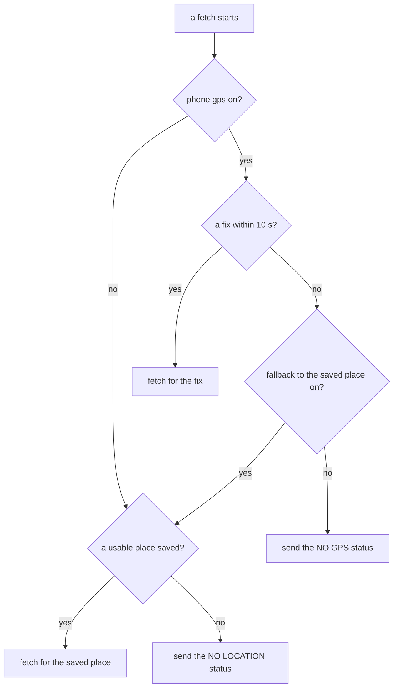

# Fetching the Weather

The weather feature gets the weather on the phone and sends it to the watch as one message: the temperature, the condition, whichever extra readings the face shows, and an hourly and a daily forecast strip. It finds the wearer's location, asks the provider the wearer picked, turns each provider's answer into the same reading, moves every time onto the watch's clock, and decides when a fetch is worth making. A face lists the feature, declares the keys for what it shows, and never talks to a provider itself.

The feature lives under `src/ts/weather/`, in [`feature.ts`](../../src/ts/weather/feature.ts), with the provider choice in [`weather.ts`](../../src/ts/weather/weather.ts), the shared parsing in [`util.ts`](../../src/ts/weather/util.ts), the condition catalogue in [`conditions.ts`](../../src/ts/weather/conditions.ts), and one file per provider in [`openmeteo.ts`](../../src/ts/weather/providers/openmeteo.ts), [`owm.ts`](../../src/ts/weather/providers/owm.ts), and [`weatherapi.ts`](../../src/ts/weather/providers/weatherapi.ts). It leans on the helpers every fetching feature shares in `src/ts/pkjs/`: [`request.ts`](../../src/ts/pkjs/request.ts), [`round.ts`](../../src/ts/pkjs/round.ts), [`asks.ts`](../../src/ts/pkjs/asks.ts), [`place.ts`](../../src/ts/pkjs/place.ts), and [`providers.ts`](../../src/ts/pkjs/providers.ts). This page covers the phone. What the watch does with the message is on [The Weather Store](weather-store.md) and [Weather Readings](weather-readings.md).

## Setting It Up

The face imports `weather` from `ts/weather/feature` and lists it when it starts:

```ts
app.startPebbleApp({
  clayConfig,
  features: [weather],
});
```

A face that leaves the feature out of `features` carries none of the weather code in its phone bundle and fetches nothing, as [Features](phone-side.md#features) covers.

**The Keys.** The weather feature brings `WEATHER_REQUEST`, `WEATHER_TEMPERATURE`, `WEATHER_CONDITIONS`, and `WEATHER_OK`, which the build adds to the face's message keys. Started without any one of them, the feature fetches nothing and logs the keys that are missing. The face picks everything else by key. The phone only sends a reading such as the humidity when the face declares its key, and only fetches the forecast when the face declares `WEATHER_FORECAST_HOURLY` or `WEATHER_FORECAST_DAILY`. `WEATHER_CONDITION_LABEL` also brings the condition's long name, such as `Partly Cloudy`, since the watch has no table of names of its own.

**The Settings.** `buildConfig` adds the provider, the API key, the temperature unit, the GPS toggle, the fallback toggle, and the saved place to the settings page when the face passes `location`, `weather`, and `temperature`. The API key hides while Open-Meteo is picked, since it needs none, and the phone keeps a key for each provider, so switching the provider shows that provider's own key, as [A Key for Each Provider](settings-page.md#a-key-for-each-provider) covers. Saving a change to any of them starts a new fetch.

**Coordinates.** A face that shows where the wearer is passes `weather.withCoords(formatCoords)` in place of `weather`, and its formatter adds the coordinate keys to every weather message. [The Location Store](location-store.md) covers the formatter and the watch side.

## Choosing a Provider

The wearer picks the source on the settings page:

* **Open-Meteo** is the default and needs no key. One request brings back the current reading, every extra, the sun times, and both forecast strips.
* **OpenWeatherMap** needs a key. Its free current weather endpoint has no UV index, dew point, day's high and low, chance of rain, or forecast, so the phone asks Open-Meteo for those at the same moment. A face that shows none of them skips the Open-Meteo call.
* **WeatherAPI.com** needs a key. Its two day forecast covers every reading, but it has no strips in the shape the watch takes, so when the face shows a strip the phone borrows it from Open-Meteo at the same moment.

The phone runs the paired requests side by side and sends the result to the watch once both have answered. When only the Open-Meteo half fails, it still sends the reading, just without the borrowed parts. [The Weather Store](weather-store.md) covers how the watch keeps today's high and low from going stale when that happens.

**The Key.** The phone trims it and cuts it to 64 characters, the most the settings page takes. With OpenWeatherMap or WeatherAPI chosen and no key saved, the phone sends a `NO API KEY` status without making a request.

**Offering Fewer.** A face can list the weather providers it offers in its appinfo's `providers`, and the manifest then asks only for their sites. OpenWeatherMap and WeatherAPI keep `open-meteo.com` for the parts they borrow. [What the Phone Lets It Reach](phone-side.md#what-the-phone-lets-it-reach) covers the list.

## From a Pebble App Plugin

A face built with `PLUGIN_WEATHER` can also offer **Pebble App: Preferred Source** on its Data Source select, or take its weather from the plugin alone, as [Pebble App Plugins](plugin-sources.md) covers. The saved `WEATHER_PROVIDER` picks the mode. With `plugin` saved, or nothing saved while a plugin serves the weather, the phone subscribes to `weather/location` rather than fetching, and the Pebble app routes the subscription to the weather plugin the wearer prefers. Every other value fetches as above. The mapping is in [`weather.ts`](../../src/ts/plugin-sources/weather.ts) and the mode in [`weather-driver.ts`](../../src/ts/plugin-sources/weather-driver.ts), both under `src/ts/plugin-sources/`.

**The First Place.** A weather plugin serves one place per location in the Pebble app's weather list, and the phone reads the first. Its update becomes the same reading a fetch gives and goes out through the same sender, so the watch takes it through the keys it already has. The phone asks the plugin for the name, the temperature, the sky, the sun times, the WMO codes, and the hourly day flag on every subscription, since the night check reads the sun, and for each extra and strip only when the face shows it. A plugin that serves none of an extra leaves it on its dash.

**Turning It into a Reading.** The phone converts each temperature to the face's unit and each wind speed to km/h from whatever unit the plugin names. A temperature outside -99 to 199, or an extra outside what it can really reach, is the plugin's way of saying it has none, and is left out rather than clamped, so the watch keeps its dash. The sky's code becomes the condition token, with the night form after dark, judged against the place's own sun times. Where those give nothing, as through a polar night, the plugin's `hourly_is_day` for the hour says whether it is dark, and with neither it counts as day.

**The Extras Beyond the Standard.** The phone reads the pressure from `pressure`, the dew point from `dew_point`, and the finer sky from `weather_code` when a plugin serves them. A plugin that serves the dew point and the sky only as hourly series, as Weather+ does, has `hourly_dew_point` and `hourly_weather_code` read at the current hour, the point whose stamp is at or before now. The pressure comes from `pressure` alone, since a plugin's `hourly_pressure` can be the pressure at the ground, as Weather+'s is, which reads about 120 hPa low in Calgary beside the sea level pressure a face shows. Each value is converted by the unit it names: a pressure from hPa, mb, kPa, mmHg, or inHg, and a temperature from °C, °F, kelvin, or degrees Rankine. A single value that cannot be used gives way to its hourly series, as a missing one does. A WMO code counts only when it is one of the codes Open-Meteo sends. It turns into the condition token through the same table an Open-Meteo fetch uses, so fog, drizzle, showers, and thunder come back that the standard's nine codes fold away, and it is taken over `condition_code` whenever the plugin serves one. The UV comes from `hourly_uv_index` at the current hour when a plugin serves a usable one, and from `uv_index` otherwise, since a face's own fetch shows the UV now and the standard's `uv_index` is the day's peak. The sky in words comes from the plugin's short text, cut to fit the watch, where the face shows `WEATHER_CONDITION_LABEL`. The label is left out when the WMO code decided the sky, since the token's own words then match it, and when it is one of the standard's codes, such as `partly_cloudy`, rather than words. After dark a label that names the sun gives way to the token's own words, so a clear night never reads Sunny.

**The Strips.** The hourly strip starts at the phone's current hour, with columns two hours apart on the phone's clock. The daily strip starts on the place's day that is the phone's today, and runs up to eight days. A column past the end of a series keeps its place with no temperature, so the watch blanks it rather than keep an old one.

**Statuses.** The watch shows `No Location` for an update with no places, which is a Pebble app with no weather location or no weather yet. It shows `No Wx Data` for a first place with no temperature it can use, and the phone log names the plugin and what it sent. It shows `No Plugin` when nothing on the phone serves the weather, plugins off included, and `No Permission` until the wearer allows Location for the face in the Pebble app. An error that leaves the subscription running, such as a denied permission after a reading has come, sends nothing, so the watch keeps that reading. When the phone ends the subscription, or no plugin serves the weather, the phone lets the last update go and sends the status.

**When It Sends.** The plugin keeps its own reading fresh and sends on every change, so the phone sends each update as it comes. A watch ask resends the last update as of now, or the status the last error calls for when there is no update to send. The slow tick only starts a subscription that is not running, such as one waiting on plugins to come back on. A save that only changes the unit sends the last update again in the new unit with no fetch, and a save that only changes the location or the key does nothing while the plugin is picked.

**A Face That Shows Coordinates.** A face started with `weather.withCoords` is offered the plugin like any other, and the phone asks the plugin for `latitude` and `longitude` too, which a plugin built on the framework serves only to a face that asks. A plugin that serves them fills the face's coordinates through its formatter, as a fetch's coordinates do. One that serves none, such as the built-in, leaves the formatter a reading with no coordinates, so the readout shows its own no fix text. The source note under the select adds that the coordinates show only from a plugin that serves them.

## Where the Location Comes From

Each fetch reads the location settings afresh and picks one place:



**The Saved Place.** The settings page saves the coordinates of the place the wearer picked, so no provider ever looks a name up at fetch time, and every provider gets the same coordinates for the same place. [`place.ts`](../../src/ts/pkjs/place.ts) drops a latitude outside -90 to 90 or a longitude outside -180 to 180, and a place with no usable pair counts as none saved.

**The GPS Fix.** The phone accepts a fix up to 10 minutes old, since a cold start has no fresh one, and the weather barely moves in that time. The Pebble app does not reliably honour the location request's own timeout, so the phone gives up after 10 seconds on a timer of its own and takes the fallback. A phone with no location service counts as a failed fix. With GPS off, the saved place is used whatever the fallback toggle says.

**Coordinates on the Way to the Watch.** The result carries the coordinates the reading was for, or for WeatherAPI the coordinates of the place it matched them to. A failed fetch carries none. The phone still runs the face's formatter on it, so a face can show its own text when there is no fix instead of keeping the last place.

## A Fetch Round

Each fetch is a round, and weather keeps to the rules every fetching feature shares. A round starts when the phone code starts, when the watch asks, on the slow tick when nothing has asked since the last one, and 250 ms after a save that changed a weather setting, as [The Background Refresh](phone-side.md#the-background-refresh) and [After a Save](phone-side.md#after-a-save) cover. A watch ask within a minute of a good reading resends it rather than starting a round.

Until its first reading lands, the watch asks again every few seconds, as [The Weather Store](weather-store.md) covers. The phone drops an ask that arrives while a round is out, so it never starts a second GPS fix or spends a second provider call. A save shuts out a round that is still running, so a reading in the old unit or for the old city cannot reach the watch after it. [The Phone Side](phone-side.md#after-a-save) covers both.

**Timeouts.** The phone gives up on a request after 15 seconds on its own timer, so every fetch gets an answer. Each try in a round also has a 60 second cap as a last guard. A round that hits it is closed and sends nothing, so a stuck round cannot block every later ask.

**Retries.** The phone tries a failed fetch again 5 seconds later, and once more 15 seconds after that, so a cold launch with the GPS still warming or the network not up yet recovers instead of sitting blank until the next poll. `NO LOCATION`, `NO API KEY`, `INVALID KEY`, `RATE LIMIT`, and `LOC NOT FOUND` are never tried again. Each of those waits on the wearer or on the provider's quota, so another try would fail the same way and spend another call.

**What a Failed Fetch Sends.** The phone sends each failed try to the watch with the ok flag at 0, a temperature of 0, and a status word in place of the condition:

| Status | Means |
| :-- | :-- |
| `NO LOCATION` | no usable saved place to fall back on |
| `NO GPS` | the fix failed and the fallback is off |
| `NO API KEY` | the provider needs a key and none is saved |
| `INVALID KEY` | the provider refused the key, as with OpenWeatherMap's 401 or WeatherAPI's codes for a bad or disabled key |
| `RATE LIMIT` | the key's call allowance is used up, as with OpenWeatherMap's 429 or WeatherAPI's monthly quota |
| `LOC NOT FOUND` | WeatherAPI matched no place to the coordinates |
| `API ERROR` | the provider reported some other error |
| `NO WX DATA` | the reply had no current reading or no usable temperature |
| `BAD WX DATA` | the request worked but the reply was not JSON |
| `NET ERROR` | the request failed or timed out with no reply to read |

The message carries no extras and no strips, so the watch keeps those as they were. The watch keeps the last good temperature and condition too and only logs the status, as [Weather Readings](weather-readings.md) covers.

## Turning an Answer into a Reading

The phone turns every provider's answer into the same reading, so nothing after that step knows which provider answered.

**The Condition Catalogue.** [`conditions.ts`](../../src/ts/weather/conditions.ts) lists every condition the watch knows, each with the short label that goes over the wire, such as `PCLDY`, and its long name. The watch's icon table is generated from the same list, as [Icons](icons.md#weather-icons) covers. The phone sends a condition the catalogue does not know as `UNKNOWN`.

**From Each Provider.** Open-Meteo's WMO codes map to the catalogue by range, and a null or unknown code reads as `UNKNOWN` rather than landing on fog. OpenWeatherMap sends a word such as `Rain` or `Mist`, which goes through a short table of provider words to the nearest condition, and its icon code splits its one `Clouds` word into partly cloudy and cloudy. WeatherAPI's numeric code is the same in every language it answers in, so it maps straight to a condition, and an unlisted code falls back to the text through the same word table.

**Day and Night.** Open-Meteo and WeatherAPI flag whether the current reading is by day or by night, and OpenWeatherMap ends its icon code in `n` after dark. After dark the phone adds `_NIGHT` to the label, as in `RAIN_NIGHT`. A reading with no flag counts as day, so a missing flag never puts a moon on the face at noon.

## The Forecast Strips

The strips always come from Open-Meteo, from the provider's own request or the borrowed one, and only for a face that declares a strip key.

**Hourly.** Eight columns two hours apart, the most the watch holds, starting at the first hour at or after now. Each carries the condition as its one byte code and the temperature, and a column after dark, by Open-Meteo's own flag for that hour, gets the night bit so the watch draws the night icon for it.

**Daily.** Eight days starting on the phone's today, each with the condition and the day's high and low. The daily strip never sets the night bit, since a whole day has no night of its own.

**Columns with Gaps.** The phone rounds a column's temperature and holds it to -99 to 199. A missing one goes over as the no-data value, since a 0 would read as a real temperature. A strip whose first hour or first date cannot be read is dropped whole, because every column in it would be labelled wrong.

## Units and Values

**Units.** The phone asks every provider for the wearer's temperature unit, so the reading arrives ready to show. When the wearer switches unit, the watch converts what it holds until the new fetch lands, as [Weather Readings](weather-readings.md) covers. Wind is always in km/h, and pressure is in hPa at sea level. Open-Meteo's ground level pressure would read about 170 hPa low in Denver, so the phone asks it for the sea level figure the other providers send.

**Units from the Pebble App.** A face built with `PLUGIN_WEATHER` converts plugin weather to its own temperature unit. A face that declares no `WEATHER_TEMPERATURE_UNIT` key has no unit of its own, even with a page default for it, since the watch goes by the key. Such a face, for example one with no settings page, takes the unit the wearer picked in the Pebble app instead, for the plugin and for every fetch alike, so one face never shows two units. The phone reads it from the Pebble app's `preferences/units`, which needs no permission, whichever source is picked. It runs no quick retry and sends the watch no status. It tries again when the weather does: on the slow tick, after a save, and when the settings page opens. When the unit changes in the Pebble app, the plugin's kept reading goes again in the new unit, and a face that fetches fetches once more. A save's refetch still waiting takes the new unit when it runs, so the change folds into it rather than fetching twice. The phone keeps the unit it last heard, so the next session starts in it. A change made while the face's phone code was not running shows on the first reading after, and the units update corrects it straight away. Until the Pebble app has given a unit the reading is in Celsius. The watch has no unit setting to convert, so it shows the number as sent, and `readout_weather_temp` writes it without a letter, as [Readouts](readouts.md#weather) covers. Wind still goes in km/h, since the watch converts it to the face's own wind unit. A face with no wind setting shows it however its own code does.

**Whole Numbers.** The phone rounds every number before it goes. The feels like temperature, the dew point, and the day's high and low are held to -99 to 199, so a provider glitch cannot overflow a three digit label. A value the provider sent as null or left out is not sent at all, so the watch shows its no-data value rather than 0% rain or a UV index of 0.

**Today's High and Low.** The high, the low, and the chance of rain are for the phone's today, since the watch keeps them as today's. A city on another date may not have the phone's today in its reply, and then the phone leaves all three out rather than taking them from the wrong day.

## Times on the Watch's Clock

The watch keeps the phone's clock, so every time the phone sends has to be on that clock, even for a weather location in another zone. [Sunrise and Sunset](sunrise-and-sunset.md) covers what that means on the face.

**Open-Meteo.** The phone sends its own time zone name with the request, and Open-Meteo answers with every time on the phone's clock. The phone only sends the name when that zone's offset matches its own clock right now, since a wrong name would put every time off. Without a name, or when Open-Meteo refuses it, the phone asks in the location's own zone and moves each time by the gap between the two clocks. A refusal costs a second request.

**OpenWeatherMap.** Its sun times come as UTC seconds, which the phone reads on its own clock.

**WeatherAPI.** Its sun times are on the location's own clock, and the phone moves them by the offset between the local time and the UTC seconds it sends beside them.

**The Strips.** The hourly strip's first hour and the daily strip's first weekday are on the phone's clock too. When Open-Meteo answered in the location's zone and the gap between the two clocks is not a whole number of hours, the hour label rounds down, so a column can read up to 45 minutes early but never behind the watch's own hour. For a city behind the phone's date, the phone takes the days before its own today off the front of the strip, so the watch never shows a finished day as one six days ahead.

## Sending It to the Watch

The finished reading goes to the watch as one message, with each extra and strip the face declares and the coordinates from the face's formatter. [The Message Formats](message-formats.md) covers how the strips and coordinates are packed.

It goes through the send queue that every message to the watch shares. The phone skips a message identical to the last one the watch took, even one from a failed retry, since every send wakes the watch's radio. [The Phone Side](phone-side.md#the-background-refresh) covers the skip, and [The Weather Store](weather-store.md) picks the message up from there.

## A Reading for a Plugin App

A plugin app that serves the weather reads it with `fetchReading(places, request, done)` from `ts/weather/providers/openmeteo.ts`, or `fetchReading(places, key, request, done)` from `owm.ts` or `weatherapi.ts` beside it. Each answers a `WeatherReading` from `ts/weather/reading.ts`, or a `ReadingStatus` with a status word, for each place in the order asked. A face's own weather goes through `fetch` and its `WeatherResult` on the phone's clock, as the sections above cover.

**On the Place's Own Clock.** A reading keeps every time in epoch seconds beside one offset from UTC, `utcOffset`, the place's offset now. Values come in °C, km/h, hPa, and compass degrees, whatever the wearer's units, so the plugin converts as it serves. Each sky is a `ReadingCondition`: the framework's condition token, a WMO code, and a day flag where the provider gives one. The WMO code is Open-Meteo's own, or the nearest one to OpenWeatherMap's or WeatherAPI.com's code, and the token always names the same sky as it. A value the provider leaves out is null, a gap, and never 0.

**The Series.** `daily` runs 8 days from the place's today, and `hourly` 48 hours from today's stamp in `daily.time`. Today is the place's, so a city a day behind the phone keeps its own today. Today's high, low, chance of rain, sunrise, and sunset are the first day of `daily`. Through a polar night or a midnight sun the sunrise and sunset are null, since Open-Meteo gives the day's midnight for both. An answer with no today in it gives `NO WX DATA` rather than a reading with empty series.

**Reading the Times.** Open-Meteo stamps every day as midnight on the one offset its answer carries. Each `daily.time` is midnight on `utcOffset`'s clock, which is the place's own midnight unless its clocks change between that day and now. On the day the clocks change, today's stamp and the hourly series start an hour off the true midnight. Read every time with `utcOffset`, and place an hour by its `time`, never by its index. The reading's own `time` is when the provider measured it, which can be up to about 15 minutes old, so just after the place's midnight it can sit before `daily.time[0]`. A plugin places now by its own clock against `hourly.time`, not by the reading's `time`.

**Several Places at Once.** Every place goes in one request, with comma-separated latitudes and longitudes, `timezone=auto` so each place answers in its own zone, and `timeformat=unixtime`. Open-Meteo works out each place's today and current hour on its offset cut down to whole hours, so a place a part hour off UTC can find its today starting on tomorrow, or still on yesterday, for up to 45 minutes either side of midnight. The request asks for a day before and after the 8 days a reading keeps, and 25 hours back to 49 ahead of the current hour, which holds the place's whole today and the 47 hours after it at any minute.

**What Comes Back.** Open-Meteo answers one place with an object and several with a list in the order asked. It refuses the whole request when any place's coordinates are out of range, so `fetchReading` leaves such a place out of the request and answers it `NO LOCATION`. A 429 gives every place asked `RATE LIMIT`, whatever its body says, and any other failed request or error answer gives every place asked the same status.

**From OpenWeatherMap and WeatherAPI.com.** Neither free plan gives series in the shape a reading keeps, so each place's current values come from the provider and everything else from one batched Open-Meteo request. A run makes that one Open-Meteo request plus one provider call a place. The provider gives the temperature, feels like, humidity, wind, pressure, and sky, read with the same fields and tables the face's fetch reads, so a reading rounds to what the face would show for the same answer. WeatherAPI.com also gives the UV and the dew point, and OpenWeatherMap's free call has neither, so those come from Open-Meteo. The series, the offset, and the sun times always come from Open-Meteo. Each sky carries the nearest WMO code, kept to the token the face gives, so `OWM_WMO` reads a shower as rain of the same strength, since the face reads OpenWeatherMap's sky by its group name. Where the face has no token, as for dust, sand, ash, or smog, the reading takes fog's code and fog's token together. Squalls and tornadoes have no WMO code near them, so they carry null and stay `UNKNOWN`.

**Their Statuses.** With no key, no request goes out and every place answers `NO API KEY`. A 429 answers `RATE LIMIT` whatever its body says, a bad key `INVALID KEY`, and WeatherAPI.com's spent monthly quota, its error 2007, `RATE LIMIT` too, since it answers nothing more until the 1st. A place whose provider call fails answers the provider's status, with Open-Meteo's answer for the same place beside it as `openMeteo`. That is Open-Meteo's own reading, which the plugin can serve as its failover with no second request, or Open-Meteo's own status, such as `RATE LIMIT`, for its ledger. A place whose Open-Meteo half fails still answers `ok`, with its current values, empty series, the provider's own offset, and `seriesStatus` saying why. It is the one `ok` reading with empty series. Any `fetchReading` answers a request function that throws as `NET ERROR`.

**What a Run Costs.** Every place not answered `NO API KEY` or `NO LOCATION` costs one provider call and one place in the Open-Meteo batch, whatever either answers. `validCoords` from `openmeteo.ts` says which places count before anything is sent. A place listed twice costs its own provider call and its own place in the batch each time. Each `fetchReading` takes an `onSend` hook that hears every request as it goes out, with what it counts as, as [Plugin Apps](plugin-apps.md#serving-the-weather) covers.

**The Weight.** Open-Meteo counts a request with more than 10 variables as variables / 10 calls, and one over more than 14 days as days / 14. `requestWeight(variables, days)` works that out, and `READING_WEIGHT` is what one place in `fetchReading` costs, 3.9 calls for its 39 variables over 10 days. Open-Meteo's rate limit headers show each place in a request counted at that full weight. OpenWeatherMap and WeatherAPI.com count each call as 1, their own `READING_WEIGHT`. The `onSend` hook hands over each request's weight as it goes out, so a plugin stamps the ledger [Plugin Apps](plugin-apps.md#counting-a-providers-calls) covers with it.
