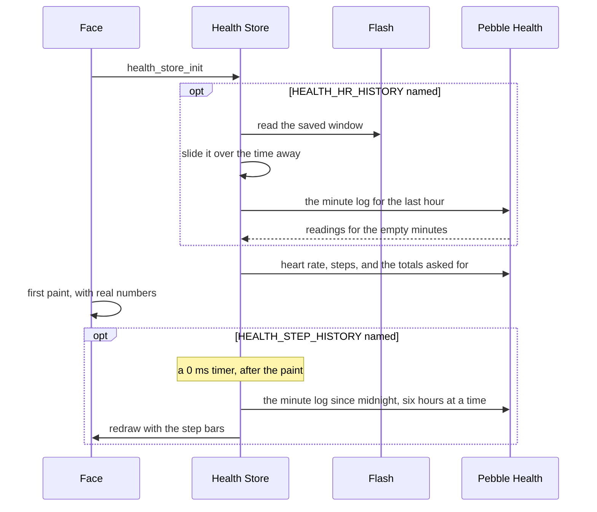

# The Health Store

The health store gives a face the wearer's numbers from Pebble Health: heart rate, steps, distance, active calories, sleep, and active minutes. For a face that draws charts it also keeps the last hour of heart rate, a reading a minute, today's heart rate hour by hour, and today's steps hour by hour. Nothing goes through the phone. What the store handles is cost. Some of these reads block on the watch's flash, the charts need scans of the watch's minute log, and Pebble Health sends events every few seconds while the wearer walks. The store holds the costly reads to once a minute, reads only what the face asked for, and keeps what it has already worked out, so a face can show health readings without a health read on every redraw.

It lives in [`health_store.h`](../../src/c/pebble/io/stores/health_store.h) and [`health_store.c`](../../src/c/pebble/io/stores/health_store.c), with its three optional parts in [`health_hr_history.c`](../../src/c/pebble/io/stores/health_hr_history.c), [`health_step_history.c`](../../src/c/pebble/io/stores/health_step_history.c), and [`health_hr_day.c`](../../src/c/pebble/io/stores/health_hr_day.c). The arithmetic behind the two charts, which hour is finished and where a minute record lands in the heart rate window, is in [`step_hours.c`](../../src/c/core/health/step_hours.c) and [`minute_window.c`](../../src/c/core/health/minute_window.c) under `src/c/core/health/`. Those are the parts that can be wrong without anyone noticing, such as a bar that quietly loses the last minute of every hour, so they sit in `c/core` (see [Where the Code Lives](index.md#where-the-code-lives)). The store takes its turn on the face's cadence like the others, as [How the Stores Work](stores.md#riding-the-faces-cadence) covers, but it asks the watch rather than the phone.

## Setting It Up

The face starts the store with the readings it shows turned on, then subscribes its redraw:

```c
health_store_init((HealthConfig){.live = true, .hr_history = HEALTH_HR_HISTORY, .distance = true,
                                 .persist_key = HEALTH_KEY}, NULL);
health_store_subscribe(redraw);
```

The face also lists `health` under `capabilities` in its `pebble.appinfo.json`, as the SDK asks of any app that reads Pebble Health.

The heart rate and the step count are always read. **`sleep`, `active`, `calories`, and `distance`** each turn on a read of the day's sleep, active minutes, active calories, and walked distance. A total left off is never read, and its getter keeps returning its no-data value.

The three charts are parts, and the face turns one on by naming it:

* **`.hr_history = HEALTH_HR_HISTORY`** keeps the hour of heart rate for a graph, and saves it to flash under `persist_key`.
* **`.step_history = HEALTH_STEP_HISTORY`** keeps today's steps by the hour for a bar chart.
* **`.hr_day = HEALTH_HR_DAY`** keeps today's heart rate by the hour, with the day's low, average, and high, as [Heart Rate Through the Day](#heart-rate-through-the-day) covers.

A part left out costs the face its code. The store only reaches a part through the pointer the face names, so for a face that never names one, nothing points at the part's code, and the linker leaves it out. A face that still calls the part's getter, such as from a panel it builds but never shows, keeps the getter and its buffer, which answers empty. A seed's curve for a part that is not named is not taken.

A `HealthSeed` pins fixed numbers and curves for screenshots, as [How the Stores Work](stores.md#seeded-for-screenshots) covers.

## What Each Read Costs

**Heart Rate.** A peek at the watch's current reading, which is cheap. A watch with no heart rate sensor, or no reading yet, gives -1, and the framework's `readout_hr` draws dashes for it.

**Steps.** Today's total. The watch keeps it to hand, so it is cheap too. No reading, such as with Health turned off, gives -1.

**Sleep, Active Minutes, Calories, and Distance.** Each of these costs a blocking flash read every time it is asked for, which is why a face pays only for the ones it shows. Sleep and active minutes arrive in seconds and are turned into minutes. Sleep is the watch's total for today.

**Distance Reads 0 for No Data.** Distance gives 0 rather than -1 when there is no reading, so it cannot tell a quiet morning from Health being off. A panel tells the two apart by the step count, which is -1 with no data. The settings page's Stats Readout control can switch the steps readout to distance in miles or kilometres, and a face that offers it turns `distance` on.

Every read first asks the watch whether the reading exists for the span, and takes the no-data value when it does not. A platform built without Pebble Health reads nothing at all, and every getter stays at its no-data value.

## When It Reads

Pebble Health sends an event when something moves, and the store reads only what that event touched:

* **A heart rate update** reads the heart rate.
* **A movement update** reads the day's totals. These arrive every few seconds while walking, and the totals move once a minute at most, so the reads are held to one round a minute and most movement events read nothing at all.
* **A significant update**, such as the day changing, marks every number stale, so it reads everything at once past the minute limit.

Events alone are not enough. Heart rate events are sparse, so a graph built only from them would be dots rather than a line, and movement events stop the moment the wearer sits still, which would leave the step count where it was. So the store also reads on each turn of the face's cadence, normally the minute tick. A turn that lands in a minute an event already covered reads nothing new.

**A Redraw Only When Something Moved.** The store sums its readings before and after each round and asks the face to redraw only when the sum changed. Most minute ticks bring back the same numbers, and a redraw for nothing would rerun every health panel. A face graphing the heart rate still gets a redraw a minute, since its window slides.

## The Heart Rate Window

The window is 60 one-byte slots, oldest on the left and the current minute in the last slot, with 0 meaning no reading. Each time the store reads the heart rate it writes the watch's current reading into the current minute's slot. When the minute moves on, the window slides left and the minutes that passed with no reading are left at 0. A clock that jumps back would put the window's minutes in the future, so it starts over from the new time.

A graph reads the window through `health_store_hr_history`, which hands back a read-only pointer to the 60 slots:

```c
const uint8_t *history = health_store_hr_history();

for (int minute = 0; minute < 60; minute++)
{
    // a point at history[minute], with 0 a minute that had no reading
}
```

**Why Not the Watch's Own Log.** The watch keeps a minute by minute log, but it only records a heart rate in it now and then. A graph drawn from the log alone would be mostly empty. Peeking the live reading every minute fills it.

**Saved Once a Minute.** The window lives in memory, and a face is closed whenever the wearer opens an app. So on a real reading the store saves the window to flash, at most once a minute. A burst of heart rate events can bring a reading a second, and a flash write blocks, so the limit keeps a burst to one write. The save runs while the store is already awake for a reading, so it costs no extra wake. Saving less often would bring the graph back missing its last few minutes every time the wearer opened an app.

**Back from an App.** On a relaunch the store reads the saved window back, slides it forward over the time the face was away, and clears it if that was an hour or more. Then it fills the empty minutes from the watch's log, so time spent in a watchapp shows whatever the watch recorded. A minute that already holds a reading keeps it, since the live readings come more often than the log's. The log runs behind the clock and its first record can be any minute in the hour, so each record goes in the slot for its own minute rather than in order from the left. With the window ending on the current minute, a first record 50 minutes old lands in slot 9. The read takes room for 60 records, about 720 bytes, from the heap and gives it back straight after.



## Steps by the Hour

The chart has 24 buckets, one per hour from midnight. A quiet hour is a real 0, so the store also says how many buckets are real with `health_store_step_hours`, and a chart draws that many rather than looking for a marker:

```c
const uint16_t *hourly = health_store_step_hourly();
int hours = health_store_step_hours();

for (int hour = 0; hour < hours; hour++)
{
    // one bar of hourly[hour] steps
}
```

**The Hour in Progress Is Free.** Its bar is today's total less the finished hours, so it needs no read of its own. The total and the log come from different places in the watch, so a step or two of disagreement can land on this bar.

**A Finished Hour Is Read Twice, Then Kept.** Reading an hour means scanning the watch's minute log, which blocks. The watch writes each minute's record at the top of the next minute, and at a lower priority than the face. So on the turn the hour rolls over, its last minute is usually not in the log yet. The store reads the hour just gone at the rollover and once more a minute later, then never again for the rest of the day.

**Catching Up at Launch.** A face started partway through the day has every hour since midnight to read. The store reads them six hours at a time, since a scan costs the same whatever span it covers. A launch at 15:30 has fifteen finished hours, which is three scans of six, six, and three. Even batched that is several blocking scans, so the first catch-up waits for a timer that runs after the face's first paint. The face appears straight away and the bars fill in a moment later.

**Room from the Heap.** The scans share room for seven hours of minute records, 420 records of 12 bytes or about 5 KB, from the heap, and give it back when they are done. What a face runs out of first is its app image, and the heap does not count towards it. When the heap is too full to lend it, the scans wait for the next turn.

**Days the Clocks Change.** Each bucket is an hour on the wall clock, so on a 23 or 25 hour day the bars still line up with the hours the chart labels. The batch that holds the repeated hour in autumn runs an hour longer in real time, which is why each scan has room for seven hours rather than six. A new day, or a clock that jumps back, drops the buckets and reads them again.

## What the Histories Cost

A part the face names carries its code and its buffer, 60 bytes for the heart rate graph, 48 for the steps, and 144 for the heart rate day. A part it leaves out carries neither, unless the face calls its getter, which keeps the buffer. Without the heart rate graph there is no read of the log at launch, no window sliding each minute, and no flash write. Without the hourly steps there are no log scans and no 5 KB borrowed from the heap. A face that shows only a heart rate and a step count pays for two cheap reads a minute.

## Heart Rate Through the Day

With `HEALTH_HR_DAY` named, the store keeps every heart rate reading of today in its hour, as an [`HrDay`](../../src/c/core/health/hr_day.h). `health_store_hr_day` hands it back, `hr_day_hour_avg` gives an hour's average for a bar, and `hr_day_stats` gives the day's low, average, and high. An hour with no readings answers -1, so a chart leaves a gap rather than a bar at 0.

The watch only answers a heart rate low, average, or high over the last two hours, so the day cannot come from those. It does log a heart rate in the same minute records as the steps, kept as long as the steps are. So once the face has painted, the store reads the log from midnight up to the minute it started, in the same six hour batches as the steps. From then on it adds each new reading as it arrives, at most one a minute, which keeps the minutes HRV holds the sensor on from outweighing the rest of the day. Only a heart rate event adds one, since a peek can hand back the same reading for up to fifteen minutes. The day empties at midnight.

The average weighs every reading the same, so an hour with many readings counts for more than an hour with one. The maths is in [`hr_day.c`](../../src/c/core/health/hr_day.c) with its specs. The day takes 144 bytes, only in a face that names it. `HealthSeed.hr_day` pins a day for screenshots, or prefills a live store in place of the log.

## Reading It Back

Each reading has its own getter, such as `health_store_hr` or `health_store_steps`, and each returns its no-data value until there is something to show. The framework's `readout_hr` and `readout_steps` already turn those into text with dashes for no data, as covered in [Readouts](readouts.md). The store reads every number it was asked for once during init, before the face first paints, so a face shows real numbers from its first frame rather than dashes until the first event.

## Heart Rate Variability

Heart rate variability is how much the gap between one heartbeat and the next changes from beat to beat. The watch's sensor reports each gap, and the store adds a run of them up into RMSSD, the figure fitness trackers show, in milliseconds. A higher number generally means a rested body, and a lower one stress, tiredness, or illness. `health_store_hrv_ms` hands back the reading, and `readout_hrv` writes it or dashes.

The sampling, the holds, and the movement check are in [`health_hrv.c`](../../src/c/pebble/io/stores/health_hrv.c), which only the store calls. The arithmetic, which beats count and how a run adds up, is [`hrv_run.c`](../../src/c/core/health/hrv_run.c), and the movement score is [`hrv_motion.c`](../../src/c/core/health/hrv_motion.c), both under `src/c/core/health/` with specs that run on a PC. A reading a few ms out still looks right on the wrist, so the arithmetic is pinned there.

**Turning It On.** HRV is built in only for a face that sets it in its appinfo's `defines`, as `"HEALTH_HRV": 1`. Without it the HRV fields are ignored, the getters answer none, and the linker leaves the code out. A face with it asks for a period in its config:

```c
health_store_init((HealthConfig){.live = true, .hrv_period_sec = 300,
                                 .hrv_persist_key = PERSIST_HRV,
                                 .persist_key = PERSIST_HEALTH}, NULL);

// when the wearer changes a setting, or places or removes a panel
health_store_set_hrv_period(period);
health_store_set_hrv_rules(still_mg, walk_steps, HRV_COUNT_NOT_WALKING, keep_all, live_redraw);

// and in the face's deinit
health_store_deinit();
```

`hrv_period_sec` is how often the watch takes a burst of beat gaps, and 0 turns HRV off. A face that only shows HRV in one panel can pass 0 until the panel is on a layout, since every burst costs battery. `HealthSeed.hrv_ms` gives a seeded store its reading for screenshots. The emulator never sends heart rate readings, so a seed is the only way to see the readout there.

**Stop It in Deinit.** The watch keeps an app's request for beat gaps going for an hour after the app closes. A face that leaves out `health_store_deinit` has the sensor sampling for that hour whenever the wearer opens an app from it.

**Which Watches Give a Reading.** Only a sensor that reports beat gaps gives readings, and today that is the Pebble Time 2, on emery. Gabbro and flint have no heart rate sensor, and the watch turns the request down. So does a Time 2 with heart rate turned off in its Health settings. `health_store_hrv_sampling` says whether the watch took the request. The store asks again on the face's cadence when the watch turned it down, or when no gap has come for as long as a reading takes to go stale. The asks are spaced by that same wait, three sample periods and never less than half an hour, so a wearer who turns heart rate back on gets readings again without restarting the face, and a watch with no sensor is asked about twice an hour.

### Holding a Burst

The watch turns the sensor off as soon as it has a good heart rate, which on a Time 2 is about six beats in, and a run needs 20 differences. So on the first gap of a burst the store asks for a period of one second, shorter than the sensor's warm up, which keeps it on. It goes back to the face's period once the run fills at 60 differences, goes quiet, or reaches 90 seconds. On a Time 2 a held burst took 40 to 90 seconds, longer when the heart beats slower.

**The First Gaps Are Left Out.** For its first few seconds the sensor can swap between two gaps, 730 and 620 ms on a Time 2, close enough to pass the jump rule below. Left in, those lifted one reading from 35 ms to 50. So the first 10 gaps of each burst are dropped.

### What the Wearer Was Doing

HRV only means something at rest. Walking raises the heart rate and shakes the sensor, and on a Time 2 a reading taken walking around came out at 54 ms against 27 sitting still. So each burst is marked still, busy, or walking, as an `HrvState`.

**Steps Decide Walking.** Pebble's step counter only counts a stepping rhythm, so a burst with `hrv_walk_steps` steps or more through it is a walk, 10 when the face passes 0. A wrist can move as much without walking. On a Time 2 a mouse and keyboard scored 267 with no steps, where a slow walk started at 270.

**The Wrist Splits Still from Busy.** While a burst is held the store reads the accelerometer at 10 Hz and scores the burst as the average change from one sample to the next, in milli-g, added across the three axes. A burst scoring `hrv_still_mg` or under is still, 60 when the face passes 0. On a Time 2 sitting still scored 23 to 60, and eating, gaming, and stirring a pot scored 90 to 267.

**Which Bursts Count.** `hrv_count` decides which bursts become the main reading. `HRV_COUNT_NOT_WALKING`, the default, takes still and busy ones, `HRV_COUNT_STILL` only still ones, and `HRV_COUNT_ANY` every burst. The two limits are meant to be settings, since one wearer's still is another's fidget. A burst that cannot count is dropped as soon as that is clear, which lets the sensor go early, unless `hrv_keep_all` is set. A face with a panel that shows walking or busy readings sets it, at the cost of up to 90 more seconds of sensor per burst.

**The Accelerometer Is Shared.** Its data service takes one subscriber an app, and the store holds it for each burst, so a face that reads raw accelerometer data itself cannot use HRV. Tap detection is a separate service and is not touched.

### What the Store Keeps

Every finished reading goes into an [`HrvLog`](../../src/c/core/health/hrv_log.h), read with `health_store_hrv_log` and the `hrv_log` functions. It holds the latest 24 readings with what the wearer was doing and whether Pebble said they were asleep, today's readings averaged by the hour, the night's average, and the latest reading of each state. A walking reading shows in the history and as the latest walking one, but stays out of the hours and the night. A reading taken asleep between noon and 21:00 is a nap's and stays out of the night too, since those are the hours the watch calls a sleep a nap. The log is saved under `hrv_persist_key` each time a reading lands, so a face opened again after an app still has its day. With no key it lives in memory only. `HealthSeed.hrv_log` pins one for screenshots, and a seeded log is never saved.

For a panel that helps the wearer pick the two limits, `health_store_hrv_recent` gives the last six bursts, dropped ones included, with each one's score, steps, state, how many beats it kept, and whether it counted. `health_store_hrv_live` gives the burst being held right now, and `hrv_live_redraw` redraws the face once a second while one is. `health_store_hrv_still_mg` and `health_store_hrv_walk_steps` give the limits in use, so a panel shows the same numbers as the settings. The recent bursts live in memory only, since they are for watching the numbers while moving.

### How a Reading Is Worked Out

One gap on its own is just the heart rate said another way. What changes with rest and stress is the difference between each gap and the one before it, so a run's reading is the square root of the mean of those differences squared, rounded to the nearest ms.

**Which Beats Count.** Apps never see the sensor's own quality grade, so the store decides. A gap outside a heart rate of 30 to 200 is dropped, and so is a gap of 0, which the watch gives when it has none for a beat. So is a gap more than 20 percent away from the one before it, which is what a missed beat or a doubled one looks like. Left in, one missed beat would add two differences of about a second and swamp the real variation. A dropped gap also breaks the chain, since the good gaps either side of it are not neighbours, so the next difference is taken between the two good gaps after it. That is also how a heart rate that really moved carries on: it costs one dropped gap, then the new pace is measured against itself.

**When a Run Ends.** A run needs 20 differences before its answer means anything, and finishes at 60. The gap that fills it starts the next, so a long burst loses nothing between runs. A run also ends when 15 seconds pass with no gap, which is how a burst ends and how taking the watch off shows up. That is checked on the cadence, so a burst's last run shows within a minute. A run short of 20 differences gives no reading, and the one before it stays up.

**A Reading Goes Stale.** With the watch off the wrist no run finishes, and the last reading would sit on screen for good. So a reading goes back to none once three sample periods pass without a new one, and never sooner than half an hour. A clock the phone sets back counts as no time passed, both here and for the 15 second pause.

**What It Costs.** A held burst keeps the sensor on for up to 90 seconds, and asking for beat gaps also has the watch read the heart rate, so the heart rate readout and graph get fresher as a side effect. The gaps arrive about once a beat, but only a finished run changes the reading, so the face redraws when the number moves and not on every beat. With a persist key the log is written to flash once a reading, which is once a sample period at most. A face built without `HEALTH_HRV` carries none of the code.
