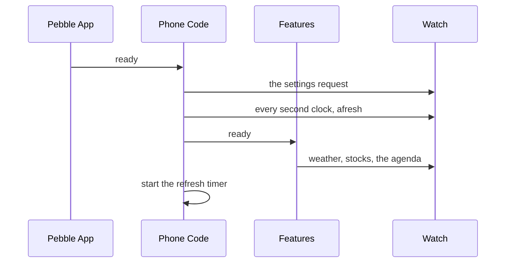
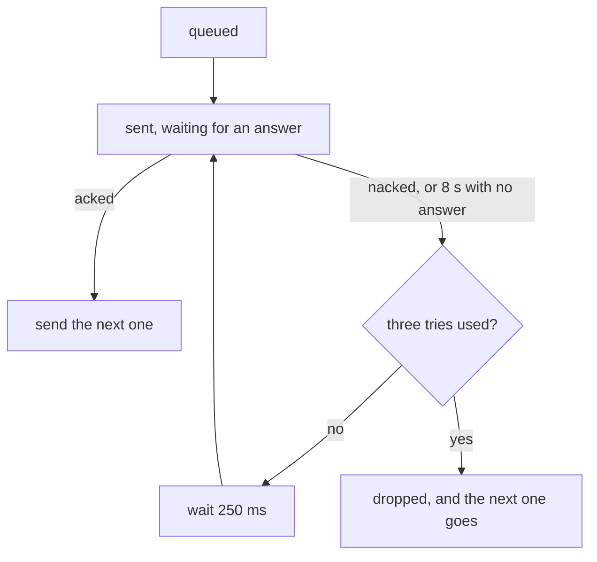

# The Phone Side

A face's phone code is its PebbleKit JS, running inside the Pebble app on the phone. The framework runs all of it from one call. `startPebbleApp` builds the settings page, puts the settings back after a reinstall, keeps second clocks right across daylight saving, sends every message to the watch through one queue, and runs the features the face opted into, such as weather, stocks, and the calendar. A face's own phone code is usually that one call and whatever formatting is its own.

It lives under `src/ts/pkjs/`, in [`app.ts`](../../src/ts/pkjs/app.ts), [`feature.ts`](../../src/ts/pkjs/feature.ts), and [`send-queue.ts`](../../src/ts/pkjs/send-queue.ts), with the rules every fetching feature shares in [`asks.ts`](../../src/ts/pkjs/asks.ts) and [`round.ts`](../../src/ts/pkjs/round.ts).

## Starting the App

A face's entry point hands `startPebbleApp` its settings page and the features it uses:

```ts
app.startPebbleApp({
  clayConfig,
  components: [slotEditor],
  features: [weather, stocks],
});
```

**`clayConfig`.** The settings page, normally built with `buildConfig`. Besides building the page from it, the app reads each setting's default, which fields are second clocks, and each slider's precision.

**`components`.** Any Clay components of the face's own, such as a layout editor. The app registers them before it builds the page, and it registers the location search that the weather location and second clocks use for every face.

**`features`.** The parts of the phone code only some faces need. Each one fetches its own data and sends it to the watch, and the app tells it when anything happens.

## Features

A feature is a function the app calls once, at start, with what every feature shares: the face's message keys, the defaults from its settings page, the send queue, how long to wait before fetching again after a save, and the providers the face lists for each kind, or `null` for a face that lists none. It hands back the hooks the app calls on it:

| Hook | When It Runs |
| :-- | :-- |
| `ready` | the phone code has started, after the settings request has gone out |
| `message` | a message has arrived from the watch |
| `refresh` | the background refresh ticked, with a flag for the slower ticks |
| `configOpened` | the settings page is about to open, while the old settings are still saved |
| `configSaved` | the settings page closed and its new settings are saved |
| `page` | the settings page is about to open, after `configOpened`, with its own copy of the page so far, and hands back the page to open |
| `components` | not a hook but a list, the Clay components the `page` rows are drawn with, which the app registers only for a page that holds those rows |
| `seeded` | the phone is filling its saved settings from the watch's reply, with those settings before they are saved and a way to read each value as the watch sent it |
| `settingsUnanswered` | the watch turned away every settings request since the last `ready`, so no reply comes until the next `ready` asks again |

Every hook is optional. A feature also lists the watch's request keys it answers, such as `WEATHER_REQUEST`. When the watch sends a request no listed feature answers, the app logs one warning naming the key, which is how a face that declares a feature's keys but forgot to list the feature finds out.

**One Feature Cannot Break the Others.** The app runs each hook on its own. A hook that throws is logged and the rest still run, so a feature that breaks on one phone cannot stop the refresh timer, the other features, or a settings restore.

**Only What a Face Lists Is Bundled.** `app.ts` never imports a feature. The face's entry point imports each one it passes, such as `weather` from `ts/weather/feature`, so the bundler leaves every other feature out of the face's phone code, along with the providers behind it. The calendar's iCal library is only copied into the build for a face whose code reaches the calendar reader. The cost is that a face has to name each feature it uses, and one it forgets fetches nothing.

**A Feature Brings Its Keys.** A feature carries the message keys it cannot run without, as `messageKeys` on the feature function. `weather` and `weather.withCoords` bring `WEATHER_REQUEST`, `WEATHER_TEMPERATURE`, `WEATHER_CONDITIONS`, and `WEATHER_OK`, `stocks` brings `STOCK_REQUEST` and `STOCK_STRIP`, and `calendar` brings `CALENDAR_REQUEST` and `CALENDAR_STRIP`. `paf build` reads which features the compiled phone code passes, without starting them, and adds each of their keys the face does not list, after the face's own. So a face lists only the keys that are its own choice: its settings, the weather groups and coordinates it reads, and the settings pair. A face's own feature can carry keys the same way. [The Keys a Face Does Not List](talking-to-the-phone.md#the-keys-a-face-does-not-list) covers the order they go in.

**A Feature Checks Its Own Keys.** Weather started without one of its four core message keys fetches nothing and logs which keys are missing, since a fetch would spend provider quota on a reading the watch cannot show. Stocks without `STOCK_STRIP` and a calendar without `CALENDAR_STRIP` skip every fetch, with no log line. A face built with `paf build` has all of them, since the build adds them.

**Reading a Saved Setting.** A feature, or a face's own phone code, reads the settings the phone keeps through [`settings-store.ts`](../../src/ts/pkjs/settings-store.ts). `getConfig` gives every saved setting, `readText` reads a text field, `readBool` a toggle, and `readChoice` a select or radio group as the number of its choice. Clay saves a select as the option's text, and the watch's reply writes a choice back as text too, so a saved choice is nearly always `"3"` rather than `3`. `readChoice` reads both as 3, and takes a whole number from 0 up or text holding only digits, as the watch does. It also takes what the watch never receives, since a toggle saved under the same key leaves `true` or `false`, or the words `"true"` and `"false"`, and reads each as 1 or 0. Each reader takes a fallback for a setting with nothing saved, and `readChoice` also gives it for a value that is no choice, such as another word or `"3a"`. `readFahrenheit` reads the temperature unit through `readChoice`, with the page's default read the same way, and the weather reads its unit through it.

**Plugins for Weather, Stocks, and the Calendar.** A face built with `PLUGIN_WEATHER`, `PLUGIN_STOCKS`, or `PLUGIN_CALENDAR` lets the wearer pick the Pebble app's plugin as the source, or takes the kind from the plugin alone, with no change to the feature it lists. The plugin code lives under `ts/plugin-sources/`, and the features reach it through its index, which the build writes with each kind that is off set to `null`. A face built without the define carries none of it. [Pebble App Plugins](plugin-sources.md) covers all of it.

**Features That Need a Plugin Define.** Now playing, in `ts/music/feature`, and the phone's battery, in `ts/phone/feature`, read from Pebble app plugins and nothing else. Each one runs only on a face built with its define in the appinfo, `PLUGIN_MUSIC` or `PLUGIN_PHONE`. Each define brings its message keys, which the build adds, and the build refuses those keys without the define, since nothing else on the phone would ever answer them. A face that lists one of them without the define gets a warning in the log saying so, and the feature does nothing. The plugin code itself stays out of the bundle of a face built without the define, whether the face lists the feature or not.

## What the Phone Lets It Reach

A pbw built as `manifestVersion` 2, the default from SDK 4.42.0 on, gets only the sites and phone features its appinfo lists in `usesPermissions`. The Pebble app holds the phone code to that list whenever the wearer has plugins turned on. A request to a site the list leaves out fails straight away, and a GPS lookup is turned away unless the list has `Location`.

**The List Comes from the Keys.** The manifest builder writes `usesPermissions` into each target's `package.json`, in [`permissions.ts`](../../src/tools/manifest/permissions.ts). `WEATHER_REQUEST` adds `Location` and the weather providers' sites. The GPS switch is a setting, so `Location` goes in for every weather face, and the phone only asks the wearer once the face looks the position up. `STOCK_STRIP` adds the stock providers' sites. `CALENDAR_STRIP` asks for the whole web instead of a list, since a calendar feed can sit on any site. `LOCATION_NAME` or a `CLOCK_TIMEZONE_` key such as `CLOCK_TIMEZONE_1` adds `open-meteo.com`, since the location and time zone pickers search Open-Meteo from inside the settings page, and the Pebble app holds that page to the same list. A face with none of these keys gets no list. A face built with `PLUGIN_CALENDAR` also lists `Calendar`, and one built with `PLUGIN_MUSIC` lists `ReadMusic`, since the Pebble app's own calendar and music plugins ask their callers for those. The phone asks a wearer about `ReadMusic` once, and only on a face that can also reach the internet. `PLUGIN_PHONE` lists nothing, since the Phone plugin asks for no permission. Each site covers its subdomains, so `open-meteo.com` takes in `api.open-meteo.com`. Every weather face lists Open-Meteo, since OpenWeatherMap and WeatherAPI borrow the readings they lack from it.

**The Providers a Face Offers.** A face can name the providers it offers for each kind of data in its appinfo, beside `defines`, and the manifest builder asks only for the sites those providers call:

```json
"providers": {
  "weather": ["plugin", "openmeteo"],
  "calendar": ["plugin"],
  "stocks": ["yahoo"]
}
```

The names are the values the provider selects save, with `ical` for the calendar's link and `plugin` for the Pebble app's Preferred Source. `music` and `phone`, for now playing and phone battery, only ever hold `["plugin"]`. Each list puts its kind in one of three modes. A list of custom providers asks for their sites alone. `["plugin"]` takes the kind from its plugin and asks for no site. A list holding `plugin` and custom providers asks for the custom providers' sites. A kind the face leaves out asks for every site its keys bring, so a face without `providers` gets the list the keys alone give. The field stays in the appinfo and never reaches the manifest, the same as `defines`.

| Kind | Name | Sites | Needs a Key |
| :-- | :-- | :-- | :-- |
| `weather` | `openmeteo` | `open-meteo.com` | no |
| `weather` | `owm` | `openweathermap.org`, `open-meteo.com` | yes |
| `weather` | `weatherapi` | `weatherapi.com`, `open-meteo.com` | yes |
| `weather` | `plugin` | none | no |
| `stocks` | `alphavantage` | `alphavantage.co` | yes |
| `stocks` | `finnhub` | `finnhub.io` | yes |
| `stocks` | `twelvedata` | `twelvedata.com` | yes |
| `stocks` | `yahoo` | `yahoo.com` | no |
| `stocks` | `plugin` | none | no |
| `calendar` | `ical` | the face's `calendarHosts`, or any site without them | no |
| `calendar` | `plugin` | none | no |
| `music` | `plugin` | none | no |
| `phone` | `plugin` | none | no |

OpenWeatherMap and WeatherAPI add `open-meteo.com` too, since they borrow readings from it. The sites keep the order of the framework's own lists rather than the face's, so the order a face lists its providers in never changes the manifest, and a face listing every provider gets the same manifest as one listing none. `Location` stays on for every weather face, a plugin only one included, since the weather plugin reads the location as well. A plugin only weather list takes the location search off the settings page with the other location rows, so `LOCATION_NAME` adds no `open-meteo.com` there. A `CLOCK_TIMEZONE_` key still adds it, since the time zone picker stays whatever the weather comes from, and a face that keeps a location search of its own with no `pluginSourceHides` mark lists `open-meteo.com` in its own `usesPermissions`. The build cannot see the mark, so it warns a face with a `["plugin"]` weather list that declares `LOCATION_NAME`, and carries on. A face whose kinds all come from plugins, with no picker left on the page, asks for no `Internet` at all. The example above, built with `PLUGIN_WEATHER` and `PLUGIN_CALENDAR`, gets `Location`, `Calendar`, and an `Internet` entry holding `open-meteo.com` and `yahoo.com`. The settings page narrows to the same list, as [Offering Fewer Providers](settings-page.md#offering-fewer-providers) covers, so the page never offers a provider the phone would block.

**Calendar Hosts.** A calendar offering its iCal link asks for any site, since a feed can sit anywhere. A face that knows where its wearers' feeds come from lists those hosts inside `providers`, beside the kind lists, as in `"providers": { "calendar": ["ical"], "calendarHosts": ["google.com", "icloud.com"] }`, and the calendar asks for them in place of any site. They follow the other sites in the face's own order, and a host already on the list goes on once. Each is a bare host name in lowercase, and covers its subdomains. The phone checks the host the wearer's link names, not where a redirect lands, so only that host needs listing. A later Pebble app could check the redirect too. A feed on a host the face left out costs the wearer one failed fetch and a notification from the Pebble app, and loads once the wearer allows it. [Which Hosts Feeds Come From](calendar-store.md#which-hosts-feeds-come-from) lists the hosts the common calendar services use.

**What the Build Refuses.** The manifest build stops, naming the face, on a `providers` that is not a map, a kind it does not know, a list that is empty or names a provider twice, and a name the kind does not have, such as `openweather` for weather. It stops on a list for a kind the face has no key for, so `weather` needs `WEATHER_REQUEST`, `stocks` needs `STOCK_STRIP`, and `calendar` or `calendarHosts` needs `CALENDAR_STRIP`, each of which the kind's feature brings. The list and the kind's plugin define have to agree: `plugin` in a list needs the define on, and a define on beside a list needs `plugin` in it. A plugin only weather, stock, or calendar list keeps no choice on the watch, so the build refuses it beside `WEATHER_PROVIDER`, `STOCK_PROVIDER`, or `CALENDAR_SOURCE`. The face takes the key out of `messageKeys` and builds with `--clean`. The define then brings the kind's other keys and not the select key. For `calendarHosts`, the build stops on an empty list, since leaving it out is how a face allows any site, on a calendar list without `ical`, on a host that is not a bare lowercase host name with a dot, such as `https://calendar.google.com` or `*.google.com`, on an IP address, which the phone cannot match by name, and on a bare `Internet` of the face's own, which would leave the hosts doing nothing. It warns and carries on when a list's first custom provider needs a key, such as `["plugin", "owm"]`, since that provider is the default and a fresh install shows `No API Key` until the wearer pastes one.

**A Face's Own Entries.** A face that fetches from somewhere of its own lists it in its appinfo's `usesPermissions`, in the form the Pebble app reads, as in `"usesPermissions": [{ "name": "Internet", "parameters": { "domains": ["example.com"] } }]`. Its sites join the one `Internet` entry the keys made, and a bare `Internet` opens that entry to every site. A name already on the list, such as `Location`, is not added twice. An entry with no name, parameters that are not each a list of text, or a `plugin` that is not text stops the build.

**A Blocked Request.** A site the wearer has not allowed fails at once. iOS reports status 0 and Android a 403 with an empty body. Neither carries a provider's error, so weather reads it as `NET ERROR` and tries again. A stock provider reads it as `NET ERROR` too, apart from Finnhub, which reads any 403 as `NO ACCESS`. None of them reads it as a bad key.

**An Older SDK.** An SDK before 4.42.0 builds a pbw the Pebble app reads as a legacy app, which ignores the list. The build stops at configure on one and names the SDK to install. SDK 4.44 is the oldest the framework supports.

## When the Phone Code Starts

The Pebble app starts the phone code when the face opens, and fires `ready` once it is up. The app then does the same things in the same order every time:



**The Settings Request.** It goes out first. A phone that already has settings only asks whether the watch booted empty. An empty phone asks for the watch's whole copy. A face without the settings keys sends no request. The watch turns away anything that arrives before the face has opened its connection, which can be a moment into a launch. The queue gives up after three quick tries, so when the watch turns the request away, the app waits a second and sends it again, up to 8 more times. The app never asks again for a request the watch took, since the watch queues its reply before it acks, and the first reply ends the run. A repeat of the reply is ignored. What happens with the answer is on [The Life of a Setting](life-of-a-setting.md#after-a-reinstall).

**Every Second Clock Again.** A watch that has just been reset holds no zones, so the app forgets what it last sent and sends every second clock again. [Time Zones](time-zones.md#following-daylight-saving) covers what it sends. A push the watch turned away because the face was not listening yet goes again when the watch's settings reply lands.

**Each Feature Fetches.** A feature's `ready` forgets what the watch last took from it and fetches, so a watch that rebooted with empty stores always gets an answer. The stock feature may hand over the strip it kept on the phone instead, when its quota rules hold the fetch, as [The Stock Store](stock-store.md#surviving-a-restart) covers.

**The Timer Starts Fresh.** The phone suspends PebbleKit JS whenever it likes, and the timer goes with it, so every `ready` stops any old timer and starts a new one.

## Messages from the Watch

The Pebble phone app hands over each message from the watch keyed by message key name rather than by number. The emulator keys each one both ways, under the number and again under the name, so a run there never sees the name-only form a phone sends. The app fills in the number for every key the face declares before anything reads the message, so the settings reply and every feature see it however the phone keyed it. Every message from the watch then goes to every feature's `message` hook, and each one looks for its own request key. On its request, a feature starts a fetch unless one is already out, and forgets the copy the watch last took, so the answer goes out even when nothing changed.

The app handles the watch's reply to the settings request itself. Depending on which side has settings, it restores the watch from the phone or fills the phone's saved settings from the watch. When it fills an empty phone, each feature gets `configOpened` and `configSaved` around the fill, the same as for a save on the page. A feature whose settings moved then fetches again, so a watch set to Fahrenheit does not keep a Celsius reading fetched on the defaults.

## The Background Refresh

While the phone code runs, a timer ticks every 5 minutes. Each tick sends any second clock whose offset moved, then runs every feature's `refresh`. Every sixth tick, about every 30 minutes, is a slow one.

Weather, stocks, and the calendar act only on the slow ticks. The watch asks for each on the interval the wearer picked, so the watch leads. The slow tick only fetches when nothing has asked since the last one. A watch ask, or the phone code starting, marks the feature as asked, so a feature the watch is polling never fetches on the tick as well.

**An Ask Just after a Fetch.** The phone fetches as its code starts, and the watch's own ask lands a moment after that round has finished. Weather and the calendar keep a gap of a minute, `ASK_GAP_MS`, after a fetch that brought a good reading, and an ask inside it resends that reading rather than fetching again. A launch fetches once and the watch still gets its answer. A failed fetch opens no gap, so the next ask tries again. A save that changed a setting still fetches inside the gap, and the slow tick is unchanged. Stocks keep their own gap, as [The Stock Store](stock-store.md) covers.

**The Same Answer Is Not Sent Twice.** Each feature keeps the last message the watch took from it, and a refresh that brings back exactly the same one sends nothing. Every send wakes the watch's radio whether or not the reading moved. When a send fails every retry, the feature forgets what it kept, so the next one goes out. A watch ask and the phone code starting both forget it too, so the watch always gets an answer when it asks.

## After a Save

Each feature keeps its own list of the settings it cares about. Weather watches the provider, the key, the unit, and the location settings. Stocks watch the provider, the key, and the tickers. The calendar watches its link.

**A Snapshot When the Page Opens.** The page's new values are saved as it closes, so `configOpened` is the last moment the old ones can be read. Each feature takes a snapshot of its own settings then, and the app opens the page.

**A Fetch Only When Its Settings Moved.** When the page closes, the app sends the save to the watch first, since that is the step that saves the new values. Then each feature compares its settings with its snapshot. One whose settings changed fetches again 250 ms later, forced past any quota rule. A save that only touches a colour fetches nothing. The watch may also ask for weather after the same save, and an ask that lands in those 250 ms is folded into the forced fetch rather than starting a second one.

**One Fetch at a Time.** A feature keeps one fetch out at a time. An ask that arrives while one is running is dropped, so the watch asking again does not spend a provider call twice. The forced fetch after a save replaces one still running, and the older one's answer is thrown away when it lands, so a reading for the old city or the old unit never reaches the watch after the new one. A watchdog closes a fetch that never answers, so a stuck fetch cannot hold off every later one. Weather also tries a failed fetch again after 5 and then 15 seconds, unless the failure waits on the wearer, such as a bad key or a used-up quota.

## The Send Queue

PebbleKit JS allows one message to the watch in flight at a time, and a second one sent meanwhile is dropped with no error. At launch the settings request, the second clocks, the weather, the stocks, and the agenda all go out at the same moment. So every send goes through one queue:



Messages go out in order, one at a time. A nack from the watch usually means it was busy for a moment, so the same message goes again after 250 ms, up to three tries in all. A message that fails every try is dropped so the queue keeps moving, and whoever sent it hears that it failed. The watch's own queue waits far longer between tries, for a different reason, which [Talking to the Phone](talking-to-the-phone.md#sending-one-at-a-time) covers.

**Clay's Own Sending Is Off.** Clay can send the settings to the watch by itself when the page closes, but it would call `Pebble.sendAppMessage` directly, collide with whatever else was in flight, and lose one of them. The app starts Clay with `autoHandleEvents: false` and sends the save through the queue like everything else.

**A Lost Answer Counts as a Failure.** The Pebble app can lose an ack, and a send that waited for it forever would hold up every send behind it. After 8 seconds with no answer the send counts as failed and is tried again. An ack that turns up after that is ignored, so a send that was only slow can reach the watch twice. The watch writes nothing for a value it already holds, so the repeat costs one extra message.

**A Message That Will Not Encode.** A message the Pebble app cannot encode makes the send throw rather than fail. The queue counts it as a failed try, so the throw never reaches whoever queued something else.
