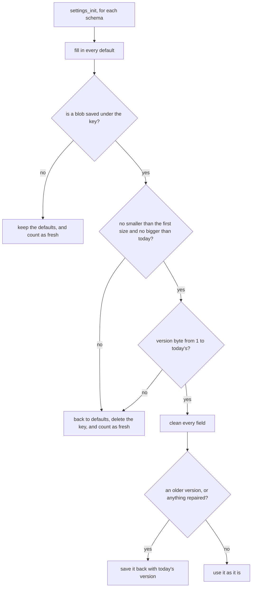

# Settings on the Watch

The settings code keeps every setting a face offers in flash on the watch, and takes care of everything around that: the defaults on a first launch, reading an older version's saved settings after an update, repairing a damaged value before the face draws it, taking new values from the phone, and sending the watch's copy back so the settings page opens filled in. A face describes its settings once, as a table, and never writes load, save, or message code for a single setting.

It lives in [`settings.h`](../../src/c/pebble/system/settings/settings.h) and [`settings.c`](../../src/c/pebble/system/settings/settings.c) under `src/c/pebble/system/settings/`, with the shared settings in [`settings_catalog.h`](../../src/c/pebble/system/settings/settings_catalog.h) and their named values in [`setting_values.h`](../../src/c/pebble/system/settings/setting_values.h). [The Life of a Setting](life-of-a-setting.md) follows one setting from the page to the screen. This page stays on the watch and goes into the machinery underneath.

## Describing the Settings

A face keeps its settings in a plain struct whose first byte is a version number. A table of fields says where each setting sits in that struct, and a schema hands the struct, the table, the version, and a persist key to `settings_init`. A common setting takes one line, and a face's own takes one entry:

```c
static const SettingField s_fields[] = {
    KNOWN_THEME(offsetof(FaceSettings, theme), THEME_COUNT),

    // this face's own setting, a choice of the layouts its settings page offers
    { .id = SETTING_COUNT, .message_key = &MESSAGE_KEY_APPEARANCE_LAYOUT,
      .type = SETTING_ENUM_U8, .offset = offsetof(FaceSettings, layout),
      .enum_count = SETTINGS_COUNT(APPEARANCE_LAYOUT),
      .default_num = SETTINGS_DEFAULT(APPEARANCE_LAYOUT) },
};
```

**A Field.** Each entry names its message key, its type, and its offset in the struct. The type is a toggle, a choice from a list, text in a fixed buffer, or a colour, and it decides both how the value travels and how it is checked. A choice carries how many options it has and which one is the default. Text carries its buffer size and its default string. Flags mark the side effects: a change to the date or time format re-renders the clock, and a change to the temperature unit asks for fresh weather.

**The Shared Entries.** The `KNOWN_*` macros fill in a common setting whole, with its message key, type, limits, default, and side effects. A face gives the offset. A list the framework owns takes its count from `setting_values.h`, where each list ends in one, such as `TIME_FORMAT_COUNT`, since the watch can only draw the values its own enum names. The wind units are the core's `WindUnit` from `units/wind.h`, which `setting_values.h` includes, so `KNOWN_WIND_UNIT` takes `WIND_UNIT_COUNT` from there. Its default is the page's, and km/h on a page with no wind unit row. A face reads it with `settings_u8(SETTING_WIND_UNIT)` and hands it to `wind_from_kmh`. The theme and the header font are the face's own lists, so `KNOWN_THEME` and `KNOWN_HEADER_FONT` take their counts from the face's settings page, and the face passes the size of its own table beside the offset, such as `THEME_COUNT`. The build stops when the page and the table disagree, as [Counts from the Settings Page](#counts-from-the-settings-page) covers. Every shared entry takes its default from the page, as [Defaults from the Settings Page](#defaults-from-the-settings-page) covers, so `KNOWN_DATE_FORMAT` takes the offset alone.

A shared entry lets the framework's own code find the setting. The date and time readouts read the formats, the steps readout reads its mode, and the Bluetooth vibration reads the pattern the wearer picked, all with no plumbing from the face:

```c
uint8_t time_format = settings_u8(SETTING_TIME_FORMAT);
const char *format = settings_str(SETTING_DATE_FORMAT);
```

`settings_init` builds a lookup from each shared id to its field once, so a read is an array index and a pointer offset. A read of a setting the face never declared gives 0 or an empty string. A shared entry names its message key directly, so a face that uses `KNOWN_THEME` without declaring `APPEARANCE_THEME` in its message keys fails to build at that line rather than on the watch.

**A Face's Own Settings.** A setting only one face has goes in the same table with an id of `SETTING_COUNT` or more. The framework still fills in its default, cleans it, saves it, and carries it to and from the phone. It just has no typed read, so the face reads it straight off its own struct. A choice of the face's own takes its count from the page with `SETTINGS_COUNT(KEY)` when the page offers it, with `SETTINGS_COUNT_CHECKED(KEY, table_count)` when the C draws it from a table of its own, or from the face's own enum when the C decides the list. Any field of the face's own can take its default from the page with `SETTINGS_DEFAULT(KEY)`.

### Counts from the Settings Page

A choice's count is how many values the watch takes, and the list it counts is the settings page's options, since those are what the wearer can pick. So `paf build` reads the count off the page rather than having the face write it twice. Between the phone build and `pebble build` it loads the face's compiled page the way the phone builds it, with the face's features started, their page hooks run, and the page narrowed to its `providers` list. It loads the page once for each platform in the appinfo's `targetPlatforms`, or for every platform the SDK has when the appinfo lists none, since the SDK then builds them all. Then it writes `page/settings_page.h` into each sandbox:

```c
// written by paf build from my-face's settings page. never edit or commit it
// format: 2
// sandbox fingerprint: 3f9a…
// counted on: emery gabbro
#pragma once

#define SETTINGS_COUNT_APPEARANCE_THEME 9
#define SETTINGS_COUNT_APPEARANCE_THEME_MODE 3
```

**Which Controls Count.** Every `select`, `radiogroup`, and `themePreview` on the page, sections included, whose option values are all whole numbers from 0 to 254, as numbers or as text holding only digits. A control with a text value, such as the date format or a provider, gets no count, and neither does one with a value past 254, since `enum_count` is a byte.

**The Highest Value Plus One.** The count is not the number of options. A face that lists its themes 0, 3, 4, 7, 8, 1, 5, 2, 6 gets 9, and one that retires theme 2 from the middle of its list still gets a count that takes the last theme, so the number stays reserved.

**The Largest Count Wins.** One pbw holds every platform the face targets, so the watch's table has to take the most any of them offers. A key with two controls, such as a rectangle-only and a round-only picker kept apart by Clay's `capabilities`, counts as the larger of the two. So does a page whose hooks offer one platform more choices than another. A key where any control has a text value gets no count at all. A key with an index, such as `SLOT_MODE[1]`, counts under `SLOT_MODE`.

**A Fresh Phone.** Each load is on a phone with no plugins and nothing saved, and the phone's globals go back as they were after it, so each face in `paf build all` starts clean. A face must not add a whole number option only when plugins are on or something is saved, since the build never sees it. The framework's own page hooks add only text options, such as the plugin choice on a provider picker.

**Using It.** `SETTINGS_COUNT(APPEARANCE_THEME)` is the count, as a number the compiler knows. A key the page has no count for stops the build at that line, with `SETTINGS_COUNT_APPEARANCE_NIGHT_THEME` undeclared. `SETTINGS_COUNT_CHECKED(key, table_count)` is the same count, checked against how many entries the face's own table holds, which is what `KNOWN_THEME` and `KNOWN_HEADER_FONT` use. A theme added to the page and not to the C would be picked and draw nothing, and one added to the C and not the page could never be picked, so either stops the build with a message naming both counts. A face's own field that shares the theme table writes:

```c
.enum_count = SETTINGS_COUNT_CHECKED(APPEARANCE_NIGHT_THEME, THEME_COUNT),
```

**A Face with No Page.** A face with no `src/pkjs/index.ts`, or whose `index.ts` never calls `startPebbleApp`, or that passes an empty page, gets the header with no counts in it, since `settings_catalog.h` includes it either way.

**Written for This Sandbox.** The header carries a fingerprint of the sandbox's `package.json` and everything under its `emit/`, and the waf build works it out again and compares. A sandbox without the header, one whose phone code was compiled again after it was written, or a header written by another version of `paf build`, which the header's `// format:` line names, stops the waf build with a line saying to build the face with `paf build`, so the C never takes its counts from a page the face no longer ships. The header also names the platforms the page was counted on, and the waf build stops on a platform it builds that the list lacks, such as one a newer SDK adds for a face with no `targetPlatforms`.

**What Running the Page Costs.** The build runs the face's compiled `index.js` under node, with `startPebbleApp` swapped for a stand-in that records what the face hands it, and the phone's globals stubbed: a `Pebble` with a few calls, a `localStorage`, and the `message_keys` map. A face whose top-level code, or whose feature as it starts, reaches for anything else stops the build, which names the feature. Nothing calls `ready`, so no feature fetches. waf tracks the header by its contents, so a change to it rebuilds only the files that include it, with no `--clean`. The fingerprint changes with any change to the phone code, so those files compile again then too.

**The Schema.** The schema names the persist key, the version, and the table. `SETTINGS_BLOB` sets the struct, its size, and the size it had in the first release that saved it:

```c
static const SettingsSchema s_schema = {
    .key = FACE_SETTINGS_KEY,
    .version = FACE_SETTINGS_VERSION,
    SETTINGS_BLOB(s_settings, 25),
    .fields = s_fields,
    .field_count = ARRAY_LENGTH(s_fields),
};
```

The 25 is that first size, written as a number. The Smallest Blob under [Loading at Launch](#loading-at-launch) covers what it does and how to find it.

### Defaults from the Settings Page

A fresh watch holds each setting at its default until the phone sends a save, and a watch that never got one sends those defaults back for the page to open on. So the watch's default has to be the one the page opens with. `paf build` writes each one from the page into `page/settings_page.h`, after the counts:

```c
#define SETTINGS_DEFAULT_APPEARANCE_THEME 0
#define SETTINGS_DEFAULT_CLOCK_DATE_FORMAT "%b %d"
#define SETTINGS_DEFAULT_CONNECTION_BLUETOOTH_ICON 1
```

**Which Controls Give One.** Every control with a message key on the page that opens, sections included and after the features' page hooks, whose value the watch can hold. The value is the one the phone reads, so a toggle's `true` and a hidden store's `"1"` are both 1, and digit text is its number. A key a `KNOWN_*` entry keeps takes the C type of that entry's field. A face's own key is a number when one of its controls is a toggle, a colour, or a choice whose options are all whole numbers, and text otherwise, in the page's own spelling. A colour written as hex text, such as `0xFF0000`, is its number. Text is a C string, with every byte outside plain ASCII written as an escape, so an accented letter reaches the watch as the same UTF-8. A slider, a list, and a key with an index, such as `SLOT_MODE[1]`, get none.

**A Control with No Default.** Clay sets a control with no `defaultValue` to empty text, so the header gives what that opens it on. A toggle opens off, so its default is 0. A text input opens empty, so its default is empty text. A colour reads empty text as 0, which is black. A select, a radio group, or a theme picker picks its option for empty text when it has one. Without one it opens with nothing picked and saves empty text, which the watch leaves alone, so it gives no default and a shared entry keeps the framework's own.

**A Face's Own Key That Differs by Platform.** A face's own key whose round and rectangular pages open on different values gets no `SETTINGS_DEFAULT_<KEY>`, and the build log names it. A field that reads that default stops at compile with it undeclared, and one that writes its own default builds as it did.

**Using It.** Every `KNOWN_*` entry takes its default from the header, so the face writes no default for a shared setting. A shared setting the page does not show keeps the framework's own default, such as the Bluetooth icon showing, since there is no page for it to disagree with. A face's own field writes `.default_num = SETTINGS_DEFAULT(KEY)` or `.default_str = SETTINGS_DEFAULT(KEY)`. A key the page gives no default stops the build at that line, with `SETTINGS_DEFAULT_<KEY>` undeclared.

**Written Rather than Checked.** The build writes the page's default rather than comparing the watch's against it. A date format is text, and C cannot compare two strings while it compiles, so a check could never catch a date format that drifted from the page. A written default also leaves no second copy to keep in step.

**What Stops the Build.** The build checks the page before it writes the header, and stops with a line naming the face and the key on:

- a select, radio group, or theme picker whose default is not one of its own options, since the page cannot show it and the wearer cannot pick it
- a key whose controls open on two values the phone reads differently on one platform, or a key a `KNOWN_*` entry keeps that opens on two values across the platforms, since the watch keeps one default for a key on every platform
- a default for a key a `KNOWN_*` entry keeps that is the wrong kind for its field, text for a number or a number for text
- a text default for a `KNOWN_*` entry whose UTF-8 does not fit its buffer with the end of the text, such as a date format over 15 bytes, which a fresh watch would cut short
- a default for a `KNOWN_*` entry with a count of the framework's own, such as a vibe or the time format, that is past that count, since the watch holds no more choices than that whatever the page lists
- an option on one of those entries that is at or past the framework's count, since a wearer who picks it gets the default back
- a default on a counted key that is not a whole number below its count, which the watch would put back to the default and save again on every launch

The checks on a `KNOWN_*` entry go by message key, so a face's own field on a shared key, such as its own field on `CONNECTION_VIBE_CONNECT`, is held to the framework's count too.

Controls on one key that `capabilities` keep apart, so a watch only ever shows one of them, count as one platform for the defaults. The build reads both on the same platform, so they need the same default.

## Keeping a Plugin Source

A face built with `PLUGIN_WEATHER` or `PLUGIN_CALENDAR` offers the wearer the Pebble app's plugin as a source, as [Pebble App Plugins](plugin-sources.md) covers. The phone sends that choice in every save, and the framework keeps it on the watch in a schema of its own, so a reset of the Pebble app does not drop the wearer's pick back to the default. The phone fills its settings back in from what the watch sends, and the watch sends this choice with the rest. The face writes no field, version bump, or default for it.

**Which Kinds It Keeps.** The watch keeps a kind's choice when the face's define is on and it declares the kind's select key, `WEATHER_PROVIDER` or `CALENDAR_SOURCE`. Each is a text field on that key, and nothing on the watch reads it. A face whose `providers` list for the kind is `["plugin"]` has no choice to keep, since the feature reads from the plugin whatever is saved. The build refuses the select key beside that list, so the watch keeps nothing for it.

**Its Own Key.** `settings_init` chains the framework's schema on after the face's last one, and saves it under `SETTINGS_PLUGIN_SOURCE_KEY`, which is 249. Loading, cleaning, saving, taking values from the phone, and sending them back all walk it with the face's own, through one helper in [`settings_chain.h`](../../src/c/pebble/system/settings/settings_chain.h). Every face leaves 249 free for its settings and for its stores alike, whether or not it has a plugin define today, since a face that turns one on in a later release would otherwise land the choice on whatever it kept there. A face settings schema on 249 is caught: `settings_init` logs an error and leaves the framework's schema out, so the face's settings keep working and the choice is not kept. A store on 249 is not caught, since the framework never sees the keys a face hands its stores, and the store and the choice then overwrite each other.

**A Face's Own Field on the Key.** A face that still keeps its own field on `WEATHER_PROVIDER` or `CALENDAR_SOURCE` while the framework keeps that kind gets an error logged at launch. Both copies take every save, so nothing breaks, but the watch sends the key twice. Take the face's field out.

**A Face with No Settings of Its Own Still Calls settings_init.** The choice is only kept once `settings_init` has run. A face with no settings of its own, such as one whose only setting is the weather source, calls `settings_init(NULL)` at launch, before `appmessage_open`, and gets the framework's schema alone. A face that never calls it keeps nothing, and a reset of the Pebble app drops the wearer's pick. The outbox is sized from the settings reply when `appmessage_open` runs, so a call after it leaves every settings reply empty, and a reinstall restores nothing. The build cannot see whether the face calls it. The choice only reaches the phone in the settings reply, so the build stops on a face that keeps one without `SETTINGS_REQUEST` and `SETTINGS_FRESH`.

**Saved Only When It Changes.** `settings_save` writes every schema on every save, but it skips the framework's schema while the choices match what flash holds. So a save of the face's own settings costs no extra write. With nothing on flash yet it writes even the defaults, or the key would stay empty and the watch would count as fresh on every launch.

**The Default Comes from the Build.** The default has to be the page's own, so a watch that never got a save sends back the choice the phone would make anyway. The build writes it from the face's `providers` list, as `PLUGIN_SOURCE_WEATHER_DEFAULT` and `PLUGIN_SOURCE_CALENDAR_DEFAULT`. It is the first custom provider the kind's list names, wherever `plugin` sits, or with no list the page's own default, `openmeteo` or `ical`. The manifest build puts them in the target's `package.json` as `textDefines`, and the waf build hands each to the C as a string. A face cannot set either name in its own `defines`. With a list, the page defaults to the list's first custom provider too, whatever the face's own select said. The build checks the default against the face's own picker, before the list narrows it, and stops when the picker does not offer it. It also stops when the page opens on another source than the watch starts on, which a face's own select can do when the face lists no providers. Both match a provider without regard to case, as the phone does, so a picker whose option saves `OpenMeteo` offers `openmeteo`. So a face whose select defaults to anything but `openmeteo` lists its providers with that one first.

**Turning a Define On Later.** The framework's schema has nothing saved on the first launch after an update that turns a define on. So the watch counts as fresh, and the phone restores everything once, which fills the choice in with what the wearer picked rather than the default. The struct always holds both kinds, so turning the second one on in a later release reads the same saved blob, and the new kind starts on its default.

## Loading at Launch

`settings_init` loads every schema the face hands it. Each one starts from its defaults, and only then is the saved copy read over the top:



**Growing at the End.** A saved blob from an older version is shorter than today's struct. The read fills in what was saved, and the fields added since keep the defaults that were filled in a moment before. So a new version adds its fields to the end of the struct and bumps the version number, and nothing else has to happen. The cost is that a field can never be moved, removed, or given a new type, since the loader has no step that rewrites one version's layout into another.

**The Smallest Blob.** The first size a schema's `SETTINGS_BLOB` gives is the size of the struct in the first release that saved it, and it never changes after that. A blob smaller than it cannot be a saved copy of this face's settings, because every field past its end would be read from the wrong place. The struct's `sizeof` would rise with the first appended field and turn away every save from before it, so the macro takes the number itself, or a macro holding one. `sizeof`, `SETTINGS_BLOB_SIZE`, a sum such as `1 + LAYOUT_LEN`, brackets, and a cast written in place stop the build, and so does 0 or a size bigger than the struct. A constant worked out from `sizeof` somewhere else, such as an enum, still gets through, so write the number. A schema that sets `.first_size` by hand, as one does that only renamed `.min_versioned_size` when it moved from 5.0.0, still builds, but none of these checks run on it, so write `SETTINGS_BLOB`.

**Finding the First Size.** It is the struct's `sizeof` as the struct stood in the blob's first release. Build that release and print it, or add up the fields when every one is a byte wide, so the struct has no padding. To check a number, add `_Static_assert(sizeof(s_settings) == 25, "");` for a moment to a build of the struct as that release had it, and take it out once it passes. A face moving from 5.0.0 whose struct has grown no field since its first release can check it against the struct it has now. A number too big turns away the saves from every release whose struct was smaller than it, so those watches drop their settings once and count as fresh. A number too small loads a blob shorter than any release saved, such as a save from before the face versioned its settings that its `migrate` hook does not take, and reads its bytes into the wrong fields. Only the cleaning pass below catches the values that land out of range.

**Going Back to an Older Build.** A blob bigger than today's struct was written by a newer build, and this one cannot read it. The same goes for a version byte of 0 or one from the future. The settings fall back to defaults and the loader deletes the key rather than writing it, so the watch counts as fresh and the phone puts its settings back (see [The Fresh State](#the-fresh-state)). Deleting the key rather than saving the defaults means a relaunch before the phone answers still boots fresh and asks again.

## Cleaning Each Value

Flash can come back damaged, and a damaged byte in a theme number would otherwise send the face looking for a theme that does not exist. So every field is checked after a load:

* **A toggle** holding anything other than 0 or 1 goes back to its default.
* **A choice** at or past the number of options goes back to its default.
* **Text** has to end inside its buffer, hold no control bytes, and say something, unless its default is itself empty. Every byte from 0x20 up counts as text, so a city spelled with an accent keeps its UTF-8 bytes across a reboot rather than reading as damage.
* **A colour** has to be opaque. Every colour the watch paints has both alpha bits set, so a byte without them came from damage rather than from the colour picker.

Anything repaired is saved back once, so the same repair does not run on every launch. The text check is `cstring_setting_is_clean`, in [`cstring_fit.h`](../../src/c/core/text/cstring_fit.h).

## Settings across Several Keys

A persist key holds at most 256 bytes, and the watch saves only the first 256 bytes of a longer write. `SETTINGS_BLOB` stops the build for a struct over that. `settings_init` logs an error at launch for a schema written without the macro whose struct is over it, and `settings_save` logs one for a struct that is not written whole. A face with more than 256 bytes of settings chains a second schema on through `companion`, with its own key, version, and `SETTINGS_BLOB`. Loading, saving, taking values from the phone, and sending them back all walk the whole chain, and a shared setting can live in any link. `settings_save` writes every link whenever it saves. Saves only follow a message that changed a setting, so a few extra writes then cost less than a checksum per link. A link that a new build adds has nothing saved on its first launch, so the watch counts as fresh and the phone restores everything once, filling the new link with the wearer's values rather than defaults.

## Taking Values from the Phone

`settings_apply_inbox` walks the face's table and looks each key up in the incoming message. It only decodes. It hands back what moved and leaves saving and redrawing to the AppMessage layer, which [Talking to the Phone](talking-to-the-phone.md#what-happens-to-a-message) covers. A key in the message that is not in the table is ignored. Each type has its own checks on the way in.

**A Toggle or a Choice.** Each one reads through `tuple_number_or`, which takes the value whether the phone sent it as a number or as text holding only digits. Clay sends a select as text and a toggle as a number, and a face's own component can send either, so the type never decides whether a setting lands. Text holding anything but digits, such as an empty select, a word, `"-1"`, or `"3a"`, leaves the setting as it was, and so does a value of any other type. A choice past the end of its list becomes the default, so a theme of `"12"` on a face with 9 themes reads as the default theme. Digits too big for an `int32_t` count as past the end too, so they reset a choice the same way. A text setting takes only text and leaves a number alone.

**A Colour.** A `SETTING_COLOR` stays on `tuple_int_or`, so it is read as an int only, and anything else leaves it as it was. Text could be hex such as `FF0000`, and reading that as decimal would land on the wrong colour.

**Empty Text Keeps the Old Value.** An empty string only counts as a value for a field whose default is empty, such as a picker whose None is `""`. For any other field it leaves the setting alone, so a page that sends a blank date format cannot wipe the one the watch holds.

**Text Is Compared at the Size It Will Be Stored.** A string longer than its buffer is cut to fit, and the check for "already holds this value" compares only the part that fits. The date format has 16 bytes, room for 15 characters. A 20 character pattern is cut to 15 when it lands, and the next save sends the same 20 again. Compared whole, that would count as a change on every save, the settings would go to flash again, and the face would be told its date layout changed when nothing did. `cstring_fit_same` measures the incoming text the way the copy cuts it, so the second save reads as unchanged.

**Colours Round to the Watch's Palette.** The phone sends a colour as `0xRRGGBB`. Each channel rounds to the nearest of the four levels the watch can show, and the result is stored as one `GColor` byte. A grey of `0x808080` sits nearest 170 on each channel, so it is stored as `GColorLightGray` and goes back to the phone as `0xAAAAAA`.

**What Moved, Not What Arrived.** The page sends every setting on every save. A field that already holds the incoming value is skipped and flags nothing, so the three flags that come back say what really changed: anything at all, a date or time format, or the temperature unit.

## Sending the Watch's Copy Back

On launch the phone can ask for the watch's whole copy, and does when it holds no settings of its own, so the page opens filled in. `settings_serialize` writes every field in the form the page reads it: a toggle as 0 or 1, a choice as text such as `"3"` since Clay reads a select back as text, text as it is, and a colour as `0xRRGGBB`. `settings_serialized_size_max` gives the worst case the outbox is sized from, and serializing stops at the first field that does not fit. [Talking to the Phone](talking-to-the-phone.md#opening-the-connection) covers the sizing and why a reply that does not fit goes out empty.

## The Fresh State

`settings_was_fresh` is true when any schema in the chain had nothing saved at launch, or had a blob it could not read and reset. Either way some settings are on their defaults because flash was wiped, by a reinstall, a reset, or a step back to an older build. The phone holds the wearer's real settings, so the watch tells it, and the phone sends them back. [The Life of a Setting](life-of-a-setting.md#after-a-reinstall) shows that exchange.

While the watch is fresh, it only saves a message that came from the settings page, either the wearer's own save or the phone's restore. Anything else it takes stays in memory. The phone sends the current time zone on every launch, and that carries a setting too. Saving it would create the key, the watch would stop counting as fresh, and the phone would never restore the rest. Once a message from the page lands, `settings_mark_restored` ends the fresh state and saving goes back to normal.
