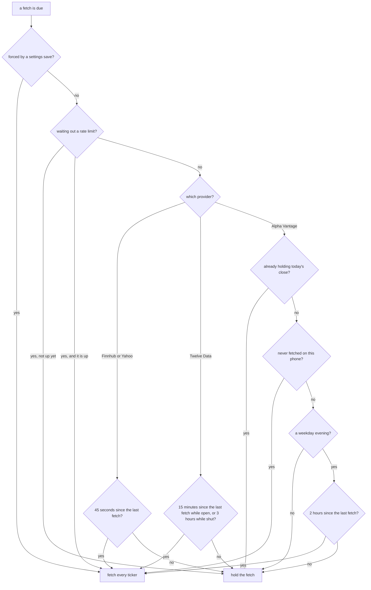

# The Stock Store

The stock store puts a watchlist of up to four quotes on the watch: each ticker, its last price, and the day's change in percent. The face never talks to a stock provider. The phone fetches the quotes, keeps each provider's daily quota in check, and sends one small packed strip. The watch keeps that strip, saves it to flash, and asks for a new one on a schedule. A face starts the store, hands it a redraw function, and reads the slots back.

The watch side lives in [`stock_store.h`](../../src/c/pebble/io/stores/stock_store.h) and [`stock_store.c`](../../src/c/pebble/io/stores/stock_store.c), and [`stock_wire.c`](../../src/c/core/wire/stock_wire.c) unpacks the strip. The phone side is under `src/ts/stock/`. The polling deadlines, the tag byte on the saved copy, and the save that skips an unchanged strip are shared with the other stores and covered in [How the Stores Work](stores.md).

## Setting It Up

On the watch, the face starts the store and subscribes its redraw:

```c
stock_store_init((StockConfig){.live = true, .poll_min = 15, .persist_key = STOCK_KEY}, NULL);
stock_store_subscribe(redraw);
```

`live`, `poll_min`, and `persist_key` mean the same as for every store, as [How the Stores Work](stores.md#the-shape-every-store-takes) covers, and a `StockSeed` pins a fixed strip for screenshots. A store started with `live` false keeps that strip, even one the face started live before.

On the phone, the face lists the feature when it starts:

```ts
app.startPebbleApp({
  clayConfig,
  features: [stocks],
});
```

A face that leaves it out does not carry the stock code or any of the providers in its phone bundle, as [The Phone Side](phone-side.md#features) covers. The feature brings the `STOCK_STRIP` and `STOCK_REQUEST` message keys, and the face declares `STOCK_PROVIDER`, `STOCK_API_KEY`, and `STOCK_SYMBOLS` for the settings. The settings page's stock section has a data source, an API key that hides for Yahoo, which needs none, and a comma list of tickers. The phone keeps a key for each provider, so switching the data source shows that provider's own key, as [A Key for Each Provider](settings-page.md#a-key-for-each-provider) covers.

## What the Watch Holds

The strip is a count and up to four slots. Each slot carries a label of up to 11 characters, the price in cents, the change in hundredths of a percent, and an `ok` flag. Whole numbers keep floats off the watch, and the framework's formatters turn them back into text:

```c
const StockSlot *slot = stock_store_slot(0);
char price[16];
char change[16];

if (!slot)
{
    // nothing has arrived yet, or the wearer cleared the list
}
else if (slot->ok)
{
    fmt_hundredths(price, sizeof(price), slot->price_cents);  // 26174 reads "261.74"
    fmt_pct_signed(change, sizeof(change), slot->change_pct); // 125 reads "+1.25%"
}
else
{
    // slot->symbol holds a status word, such as "RATE LIMIT"
}
```

`stock_store_slot` returns `NULL` past the filled count, so a panel never reads a slot that holds nothing.

**Status Words in Place of a Ticker.** When a quote fails, the phone sends the slot with `ok` false and a short status in the label: `INVALID KEY`, `RATE LIMIT`, `NO ACCESS`, `NO SYMBOL`, `NO DATA`, `NO API KEY`, `TIMEOUT`, `NET ERROR`, or `ERR`. A panel that prints the label shows the wearer what went wrong, and the longest of these sets the label width of 11 characters.

**The Limits of the Numbers.** The change rides in 16 bits, so a move past 327.67 percent either way reads as exactly that rather than wrapping, as [The Message Formats](message-formats.md#the-watchlist) covers. Only the percent change is sent, not the change in dollars.

## From the Phone to the Strip

The phone packs the strip as a count byte and then each slot end to end, a layout covered with the others in [The Message Formats](message-formats.md#the-watchlist).

**Labels Go over as Plain ASCII.** The phone flattens each label to the characters the watch fonts carry, as [The Message Formats](message-formats.md#text-on-the-way-over) covers, and cuts it to 11 characters. The settings page takes tickers up to 15 characters long, such as `BINANCE:BTCUSDT`, and the watch shows the first 11.

**A Bad Strip Changes Nothing.** `stock_wire_decode` refuses the whole of a message cut short, and the store keeps the strip it had, so it never shows half a watchlist.

**One Redraw per Strip.** A strip that reads clean replaces the whole watchlist at once, and the face redraws once for it.

## Choosing a Provider

The wearer picks the source on the settings page. Each answers one request per ticker.

* **Finnhub** is the default. It gives real-time US quotes on a free key. Its free plan refuses tickers outside the US, which shows as `NO ACCESS`.
* **Yahoo** is real-time, needs no key, and covers the most markets, including indices and crypto. It is an unofficial feed and can change without notice. It sends no change field, so the phone works the change out from the previous close.
* **Twelve Data** covers US markets on a free key that allows 8 calls a minute and 800 a day. A paid plan adds 20+ markets, with end of day prices outside the US until its Pro plan. A ticker outside the plan shows `NO ACCESS`.
* **Alpha Vantage** has end of day prices only, on a free key that allows 25 calls a day.

Each provider's free plan is in `FREE_PLANS` in `ts/stock/limits.ts`.

**Paid Plan.** A face that passes `stocks: { paidPlan: true }` to `buildConfig` gets a Paid Plan toggle under the API key, on `STOCK_PAID_PLAN`, which the face declares in its appinfo. With it on for a keyed provider, the phone leaves out the free plan's floors, Twelve Data's minute count, and Alpha Vantage's one a second gap, and fetches every ticker on every ask past the 45 second gap. A round lost to the network tries again on the next ask. A `RATE LIMIT` still sets its wait, and an Alpha Vantage limit other than its one a second backs off as Yahoo's does, so a paid plan's own limits are kept by what the provider answers. Yahoo has no key and no paid plan, so the toggle does nothing for it.

A face can list the stock providers it offers in its appinfo's `providers`, and the manifest then asks only for their sites, as [What the Phone Lets It Reach](phone-side.md#what-the-phone-lets-it-reach) covers.

The phone turns every provider's reply into the same quote shape, so the rest of the feature never knows which provider answered. Some providers report trouble in the body of a reply with a 200 status, as Alpha Vantage and Twelve Data do, so the phone reads the body for it. A hit cap then shows as `RATE LIMIT` rather than an empty quote.

## From a Pebble App Plugin

A face built with `PLUGIN_STOCKS` can also take its quotes from a Pebble app plugin serving `finance/stock`, such as Pebble's own Stocks plugin or a plugin app built on the framework, as [Pebble App Plugins](plugin-sources.md) covers. The Data Source select gains **Pebble App: Preferred Source**, or with a `providers` list of `["plugin"]` the stocks read from the plugin alone. With `plugin` saved in `STOCK_PROVIDER`, or nothing saved there while a plugin serves the quotes, the phone subscribes to `finance/stock` and calls no provider, so nothing below about quotas or the ledger applies. The mapping is in [`stocks.ts`](../../src/ts/plugin-sources/stocks.ts) and the mode in [`stock-driver.ts`](../../src/ts/plugin-sources/stock-driver.ts), both under `src/ts/plugin-sources/`. The plugin needs no permission, and a plugin only list asks for no stock site.

**The Plugin's Tickers.** A stock plugin keeps its own list of tickers, set up in its settings in the Pebble app, and serves one instance per ticker. The strip takes the first four in the plugin's order, so the API key, Paid Plan, and tickers rows hide while the plugin is picked. The first update with no tickers since the plugin was picked, or since the phone ended it, sends a strip with a count of zero. An update with no tickers after one with quotes sends nothing, since Pebble's Stocks drops every ticker it could not fetch and an offline phone answers with none, so the watch keeps its last quotes as it does after a provider round that got no answer. The cost is that a wearer who takes every ticker out of the plugin keeps the old quotes on the watch until the phone code next starts. Either way the settings page shows a note saying the phone may have been offline, or the plugin may have no tickers set up.

**Reading Each Quote.** Pebble's Stocks sends `ticker`, `name`, `price`, `day_change`, and `day_change_percent` as text, such as `$187.42`, `-$1.20`, `+0.52%`, or `CHF 98.10`. The phone reads the first number in each text, with a thousands comma as part of it and a minus before the currency as the sign, so the long price `$187.42  +0.52%` reads as 187.42. A plugin app built on the framework also sends a `numericValue` beside each, and its `currency`, `updated`, and `status`, and the phone reads the number first. A plugin that sends no percent has it worked out from the change and the price. A ticker with no price keeps its slot, with the plugin's `status` word, such as `RATE LIMIT`, or `NO DATA` when it sends none.

**What Reaches the Watch.** The phone sends each update as it comes, through the same sender a round uses, so an unchanged update wakes nothing. A watch ask resends the quotes the watch was last sent. With no update kept, the strip shows `NO PLUGIN` in its first slot while nothing on the phone serves the quotes, and `NO ACCESS` while the Pebble app refuses the subscription. A save back onto a provider forgets the strip kept for the gate and fetches past it, as any change of provider does.

**No Stock Plugin Installed.** The Pebble app has no stock plugin of its own, so the wearer installs one from the Pebble app store. Until then the Data Source offers **Pebble App: Preferred Source (No Stock Plugin)** while plugins are on, and the settings page says where to get one, as [Pebble App Plugins](plugin-sources.md#what-the-wearer-sees) covers.

**Launching with the Plugin Picked.** The cache below records the provider whose quotes it holds, and a launch with the plugin picked reads it as no provider's, so it starts empty. The first save back onto a provider then starts with no held quotes and no rate limit wait. That save's fetch goes past the gate anyway, and the ledger that keeps a counted provider inside its free plan is kept apart from the cache, so the cost is one round with no held quotes to reuse.

**The Define Taken Out.** A face rebuilt without `PLUGIN_STOCKS` has no plugin to read, so a plugin choice still saved on the phone reads as the face's default provider, for the fetch, the gate, the cache, and the ledger alike.

## Keeping Under the Quota

The watch asks on the interval the face set. On a free plan that interval can spend a day's quota by lunchtime, so the phone decides per provider whether an ask is worth a call. It reads the market's state on New York's clock: open from 09:30 to 16:00 on weekdays, the evening from 16:00 to 22:00, and shut the rest of the time.



**Twelve Data.** With four tickers and a watch asking every 15 minutes or faster, a weekday comes to at most 27 fetches while the market is open and 7 while it is shut. That is 136 calls against the 800 the free key allows.

**Alpha Vantage.** It publishes the day's close at no fixed time after the bell, so the phone tries in the evening, two hours apart, and stops as soon as every ticker's trading day is today. Each try asks only for tickers without today's close, so three tries spend about 12 calls of the 25, and nothing at all once the close is in. The ledger below holds it to 25 whatever else the day brings. A phone that has never fetched gets one call at any hour, so a new install does not sit blank until the evening.

**Finnhub and Yahoo.** They fetch on every ask, at least 45 seconds after the last one. A launch can ask twice within moments, once when the phone's code starts and once when the watch asks, and the gap keeps that to one round.

**After a Rate Limit.** A `RATE LIMIT` sets a wait, and the gate holds until it is up, ahead of every floor above.

* **Twelve Data:** a minute limit waits until a second past the next clock minute, and a daily one until a minute past midnight UTC, when Twelve Data resets each. A daily limit in the first 5 minutes after midnight is read as the minute limit, since it is the old day's count still settling.
* **Alpha Vantage:** its one call a second limit waits five seconds, then asks only for the tickers it refused. Its daily cap is left to the evening tries.
* **Finnhub and Yahoo:** neither publishes a reset, and asking Yahoo again while it blocks can make the block longer. The phone waits 15 minutes, doubling after each `RATE LIMIT` in a row up to two hours. A round that gets through clears it, and a round lost to the network leaves it as it was.

A wait of two minutes or less brings its own retry when it is up, rather than waiting for the watch's next ask. A retry set by a save comes back as a save.

**The Ledger.** For Twelve Data and Alpha Vantage on a free key, the phone stamps every call as it goes out and saves the stamps at once, under a key of their own in `localStorage`, apart from the cache. A round the phone stops partway through still counts what it sent, and a call whose send threw takes its stamp back off, since it never left the phone. A call that ends in an XHR error keeps its stamp, since the error event also fires for an answer lost after the provider counted the call, and nothing tells the two apart. Such a call still reads `NET ERROR`, and it counts as spent, so its round backs off as a timed out one does. A phone that is truly offline then spends one call a wait rather than one an ask. After a round that left a wait, the next round asks for one ticker alone, a different one each round, and asks for the rest only once that one is answered, so each try while offline costs one call however many tickers there are. Eight hours offline costs a free Alpha Vantage key with four tickers about ten of its 25 calls, where missing a counted call can run a free key past its day. A save asks for every ticker, since the wearer just changed something. A call that reached the provider but gave nothing usable, such as a `TIMEOUT`, a server error, or a page that is not the provider's answer, keeps its stamp and sets a wait of 15 minutes ahead of the floors. With nothing good in the round the wait doubles up to two hours, and with good quotes beside it the floor spaces the next fetch rather than slowing the whole list. Before a round, `allowance` in `ts/stock/ledger.ts` reads the stamps against the provider's plan in `STOCK_QUOTA_PLANS`, through the shared ledger in `ts/quota/ledger.ts` that [Plugin Apps](plugin-apps.md#counting-a-providers-calls) covers.

* **Twelve Data:** 8 calls in the clock minute and 800 in the UTC day, as Twelve Data counts them.
* **Alpha Vantage:** the last 24 hours, since Alpha Vantage does not say when its day starts again. A routine fetch stops at 20, which leaves the last 5 for the wearer's saves, and nothing passes 25.

A routine fetch with no room is held. A save, or a routine fetch with room for some of its calls, asks for what fits. The rest of its slots keep their last price or read `RATE LIMIT`, and the fetch comes back on its own when there is room for every call, asking only for the tickers it left out. Each key keeps its own stamps, so a new key starts a fresh count and swapping back finds the old key's count where it was.

**One Call a Second.** Alpha Vantage's free key refuses a call within about a second of the last, so the phone asks for one ticker at a time and waits 1.1 seconds after each answer before the next, across rounds too.

**No Holiday Table.** The schedule knows weekdays, not market holidays. On a US holiday Alpha Vantage spends its evening tries finding no new close, and Twelve Data polls at the open rate. Both stay inside their quotas.

**Clock Trouble.** A last fetch stamped in the future means the phone's clock went back, and the gate lets the next fetch through rather than shutting until the clock catches up. A ledger stamp in the future counts as sent now, so a clock that steps back cannot shrink the count. A clock set a day ahead and back again can still let a day's calls go out twice, since the stamps read as a day old while it is ahead. A phone that cannot read New York's time zone at all treats every moment as a Sunday, so a metered provider is never polled through a weekend by mistake.

**Settings That Change the Answer.** When the wearer changes the provider, the key, or the tickers, the phone forgets the old strip and its stamps, drops any fetch still out for the old list, and fetches again past the gate but inside the ledger, as [The Phone Side](phone-side.md#after-a-save) covers. A save that touches nothing stock related fetches nothing. Under Alpha Vantage that fetch asks only for tickers with no current quote held, one from the newest close the free key can have, so adding one ticker spends one call rather than four. A changed key asks for every ticker, so the new key is tried on a real call.

## Surviving a Restart

The phone kills its PebbleKit JS whenever it likes, and the gate above is only worth anything if it remembers when it last fetched. So the phone keeps a small cache in `localStorage`, under a key of its own: the time of the last fetch, the trading day of the last good quote, the last strip with a real quote in it, the last good quote for each ticker, and any wait a rate limit set. Clay rewrites its own settings blob on every save, so the cache sits beside it rather than inside it. Each field is checked on its own when it is read back, so one damaged field costs only itself.

**Whose Quotes They Are.** The cache also records the provider that fetched them, by its lowercase name. Each round compares that provider with the one the settings pick, and a cache saved under another provider is dropped, since the old provider's trading day would otherwise hold the new provider's gate shut until tomorrow. That covers a settings restore from the watch that moves the provider with no save from the page. A cache with no provider recorded reads as the current provider's own, so the first launch after an update keeps its strip and its stamps. A face whose `providers` list moves its stock provider, as [Offering Fewer Providers](settings-page.md#offering-fewer-providers) covers, has the phone empty the cache at launch, unless the new provider saved it, since a cache with no provider recorded would otherwise pass as the new provider's.

**Which Fetches Count.** A round with a good quote records the time and the trading day, the oldest day among its quotes. A round with any `RATE LIMIT` records only the time, so Alpha Vantage asks again that evening for the tickers it was refused. A round where the provider answered with nothing good, such as `NO SYMBOL` or `TIMEOUT`, still records the time, since that answer may have spent a call. A round the provider never answered, a `NET ERROR` in every slot, records nothing. When the calls never reached the host the next ask tries again, and when they reached it and came back broken, the wait above for a call that gave nothing usable comes first. Under Alpha Vantage a round with one ticker lost to the network records nothing either, since the next try asks for that ticker alone. A save whose tickers are all held spends nothing and puts back the time from before the save.

**A Passed Wait.** A wait that has passed is let go before the round's calls go out, so a launch stopped partway through cannot leave it to open the gate on the next.

**What the Watch Is Sent.** A strip with a good quote goes to the watch and becomes the kept strip. A provider's error, such as `INVALID KEY`, goes too, since the wearer has to act on it. A slot lost to the network, timed out, or refused for a rate limit keeps the last good quote for its ticker, and a round with nothing new sends the kept strip, so the watch never swaps good quotes for `NET ERROR` or `RATE LIMIT`.

**A Held Fetch Still Answers.** When the watch asks and the gate holds, the phone sends the kept strip. That matters most for Alpha Vantage after the close: a watch that was just reset would otherwise sit blank until tomorrow's evening window. The same happens when the phone's code starts and the gate holds.

**One Round at a Time.** The phone makes a separate request for each ticker and sends the strip once the last one answers, with the tickers in the order the wearer typed them. It drops a second ask that arrives while a round is out, so the quota is never spent twice for one answer. A request gives up after 15 seconds and a whole round after 30, or under Alpha Vantage after 31 seconds for each ticker it asks for, so a request that never answers cannot block every fetch after it.

**When the Phone Asks on Its Own.** The watch's asks lead, and the phone's slow refresh only fetches when the watch has not asked since the last one, as [The Phone Side](phone-side.md#the-background-refresh) covers.

**Clearing the List.** An empty ticker list sends a strip with a count of zero, which is how the watch hears that its list was cleared.

## On the Watch

**The First Ask.** A live store asks once shortly after launch, as [How the Stores Work](stores.md#polling-on-wall-clock-deadlines) covers. It needs no retry loop like the weather store's, since the phone sends a strip on its own as soon as its code starts.

**Saved to Flash.** The store saves the whole strip and the time it arrived to the face's persist key, and a relaunch shows the last strip straight away. The restore pins a count above four to an empty list and gives every label a closing zero, so a damaged copy cannot send a panel past the end of the slots. A failed write waits for the next strip that differs, for the reason in [How the Stores Work](stores.md#skipping-unchanged-writes).

**After a Lost Connection.** When the phone comes back, a live store asks again only for a strip at least its own interval old, or when it holds none, as [How the Stores Work](stores.md#polling-on-wall-clock-deadlines) covers. That ask is a routine one, so the phone's gate above holds it the same as any other, and bluetooth dropping in and out spends no more of a provider's quota than the polling would.

**How Old It Is.** `stock_store_age_s` gives the seconds since the last strip arrived, or -1 for none.
